# Sisyphus

> **Enterprise-grade database operations and governance platform**
>
> Built with **Go (Kratos v2)** and **React (Umi 4 + Ant Design 5)**. Combines SQL change workflows, multi-engine querying, wide-table services, RBAC, data archiving, and Binlog rollback.

**Languages:** **English** (this page) | [简体中文](README.zh-CN.md)

> **Development tooling:** A large portion of this project’s code was written or iteratively refined using **[Claude Code](https://claude.com/claude-code)** and **[Cursor](https://cursor.com)** (AI-assisted development). Human review, security review, and production decisions remain the responsibility of the maintainers.

[](LICENSE)
[](https://golang.org/)
[](https://nodejs.org/)

**Automation:** [GitHub Actions](.github/workflows/) — `ci.yml` (Go + frontend on path changes), `e2e.yml` (Playwright), `docker-base.yml` / `docker.yml` (images). See [SECURITY.md](SECURITY.md) for vulnerability reporting.

---

## Why Sisyphus?

In Greek mythology, **Sisyphus** was the king of Corinth who cheated death and the gods one time too many. His punishment was eternal: roll a heavy boulder up a mountain; near the summit it slips and rolls back down; he walks down and **pushes again**, without end. Albert Camus read the story as radical persistence in an absurd world. In operations, we use a simpler reading: **running databases is cyclical work**—releases, schema changes, data fixes, backups, archiving, incidents, and postmortems come around again and again, like the same slope.

This platform does not pretend the cycle stops. It **equips each ascent**: SQL orders with review and approval, goInception checks, gh-ost for safer large-table DDL, DML backup and Binlog paths when things go wrong, cron- and queue-driven archiving and tasks (Asynq), and RBAC so only the right people touch production. The boulder still rolls; **Sisyphus** helps make every push **auditable, repeatable, and reversible**.

---

## Screenshots

Same illustrations as the [User Guide](docs/GUIDE.md). Core modules (two-column layout).

<table>
  <tr>
    <td align="center" width="50%"><b>Login</b></td>
    <td align="center" width="50%"><b>Dashboard</b></td>
  </tr>
  <tr>
    <td>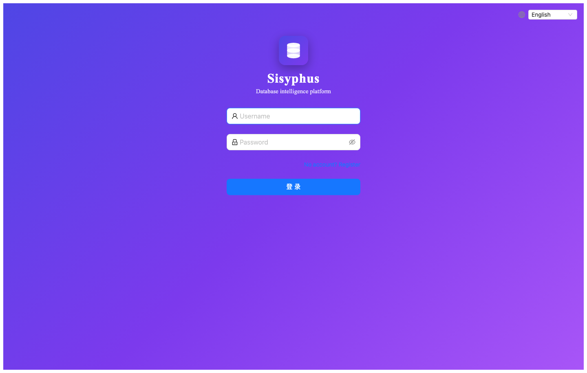</td>
    <td>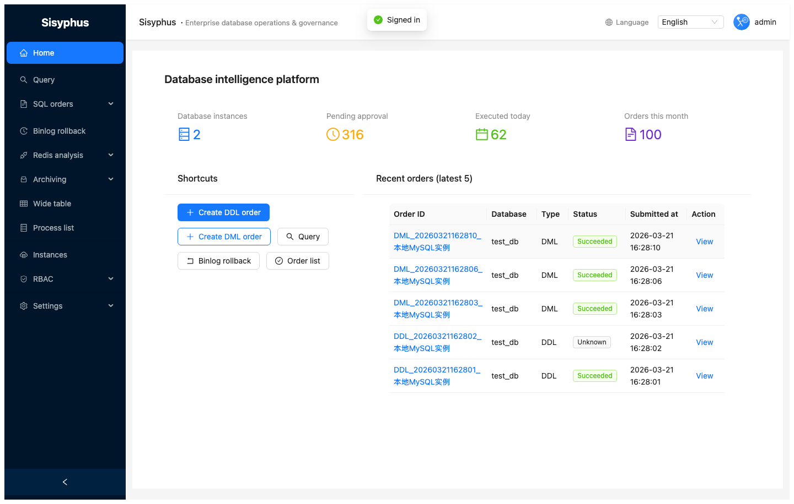</td>
  </tr>
  <tr>
    <td align="center"><b>Instances</b></td>
    <td align="center"><b>SQL orders</b></td>
  </tr>
  <tr>
    <td>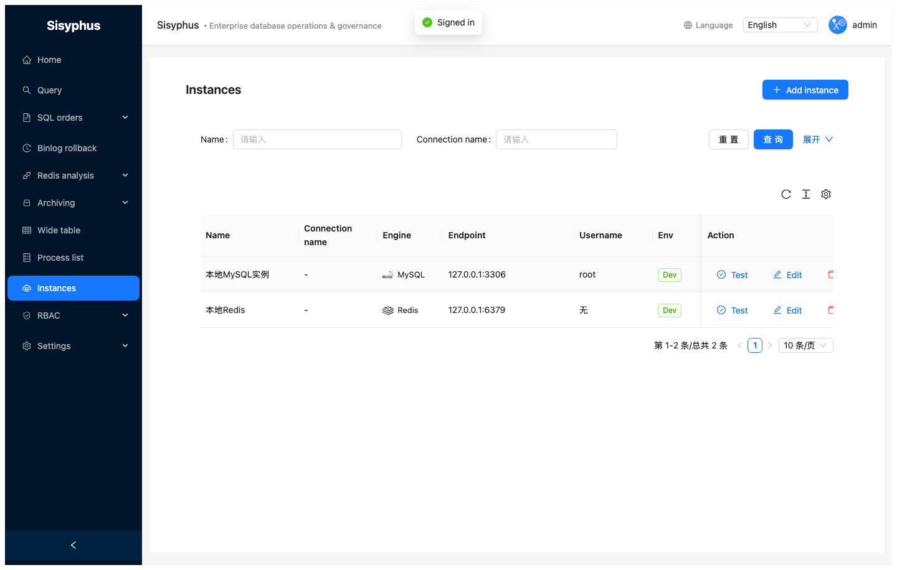</td>
    <td>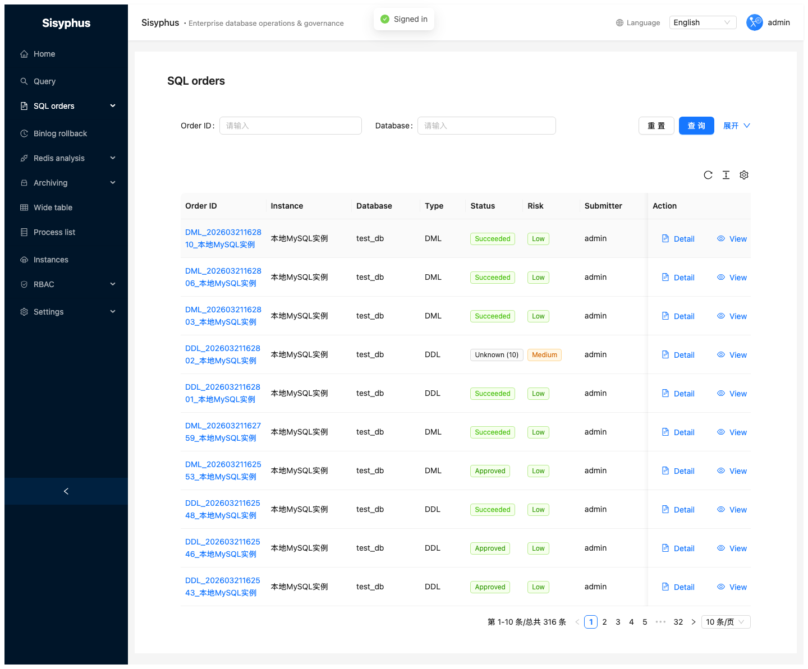</td>
  </tr>
  <tr>
    <td align="center"><b>Create DDL order</b></td>
    <td align="center"><b>Create DML order</b></td>
  </tr>
  <tr>
    <td>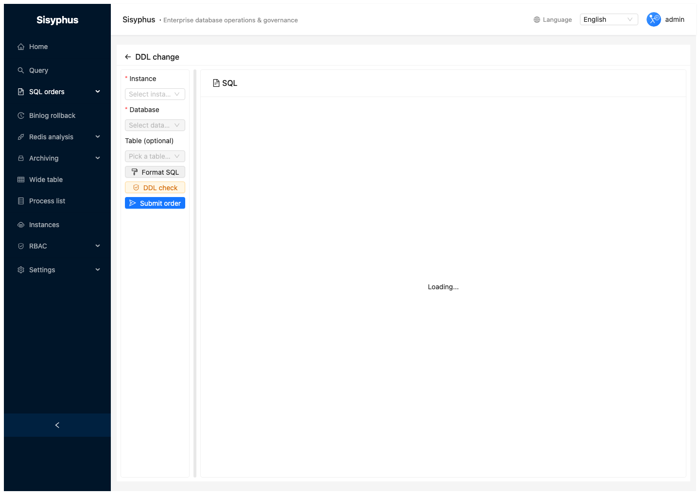</td>
    <td></td>
  </tr>
  <tr>
    <td align="center"><b>Query (Monaco)</b></td>
    <td align="center"><b>Table structure</b></td>
  </tr>
  <tr>
    <td>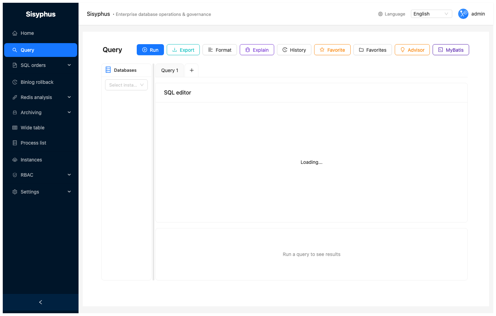</td>
    <td>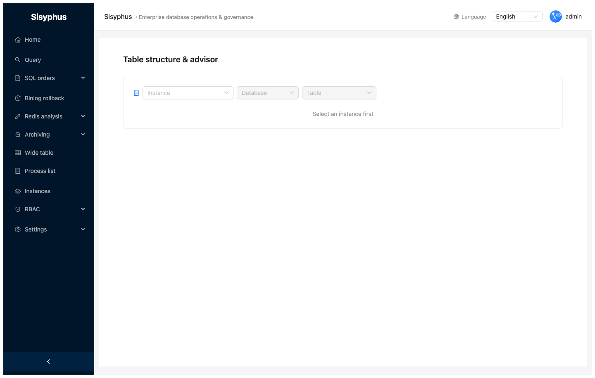</td>
  </tr>
  <tr>
    <td align="center"><b>Process list</b></td>
    <td align="center"><b>Binlog rollback</b></td>
  </tr>
  <tr>
    <td>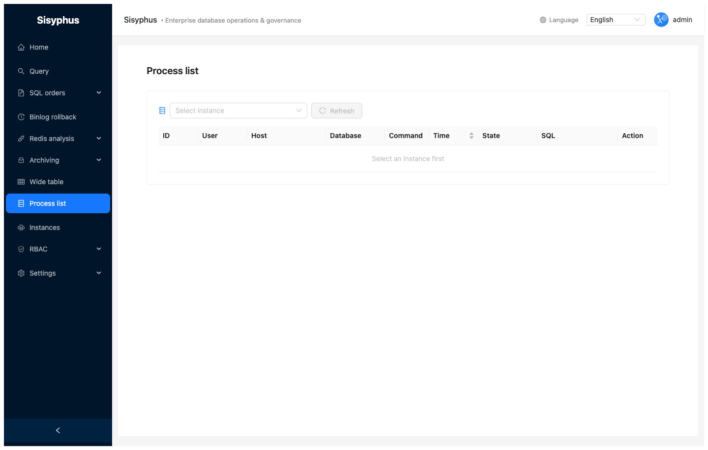</td>
    <td>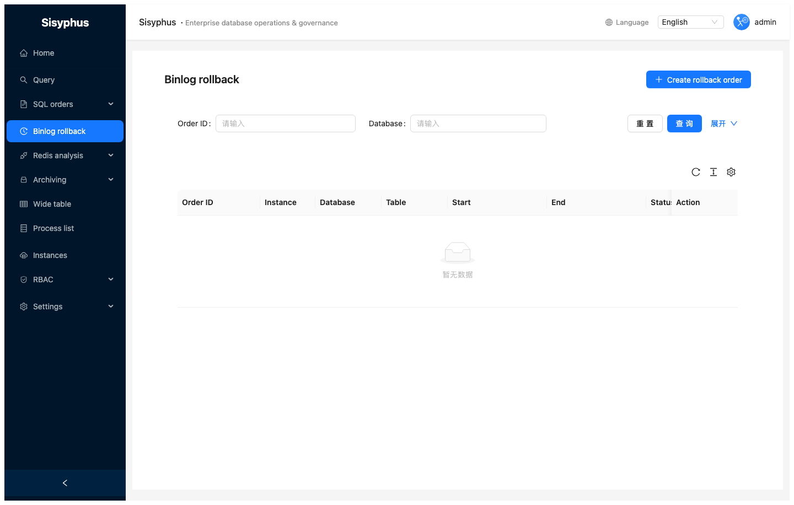</td>
  </tr>
  <tr>
    <td align="center"><b>Redis analysis</b></td>
    <td align="center"><b>Archive configs</b></td>
  </tr>
  <tr>
    <td>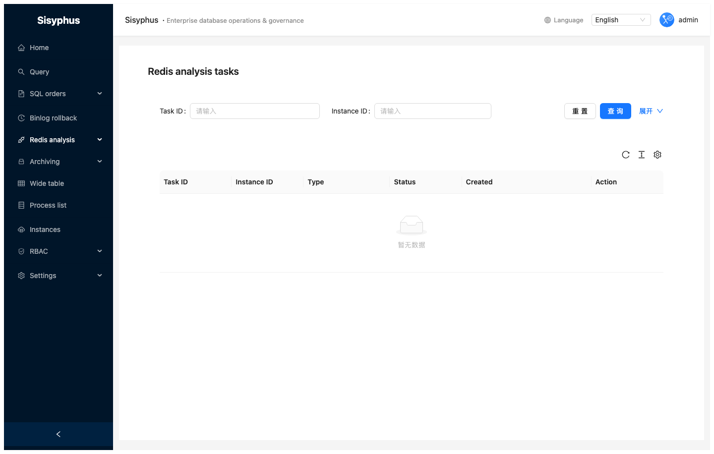</td>
    <td>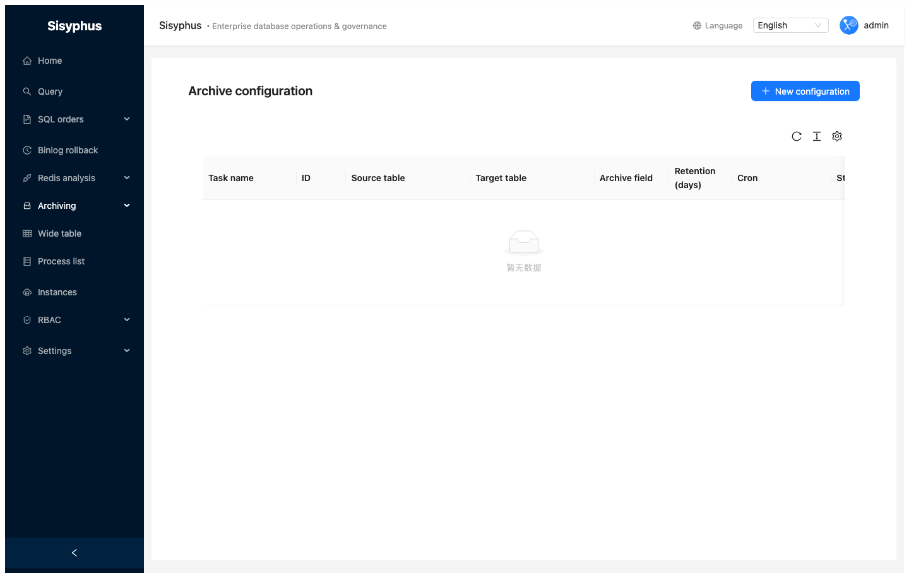</td>
  </tr>
  <tr>
    <td align="center" colspan="2"><b>Wide table</b></td>
  </tr>
  <tr>
    <td colspan="2">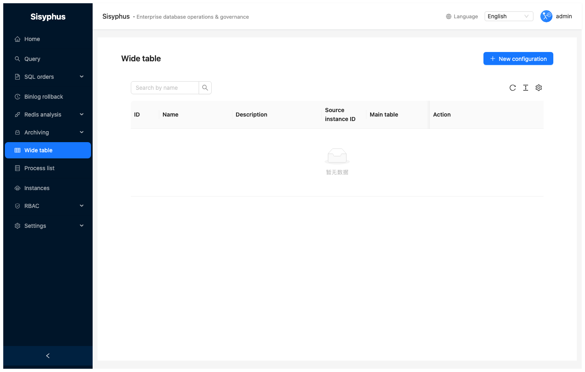</td>
  </tr>
  <tr>
    <td align="center"><b>RBAC — Users</b></td>
    <td align="center"><b>RBAC — Roles</b></td>
  </tr>
  <tr>
    <td>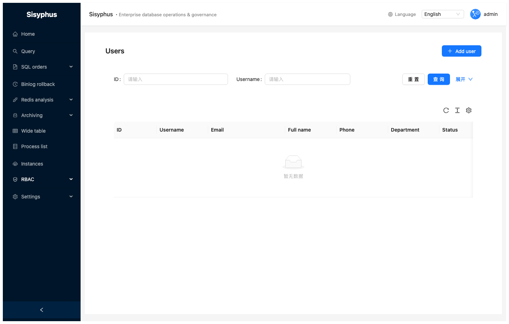</td>
    <td>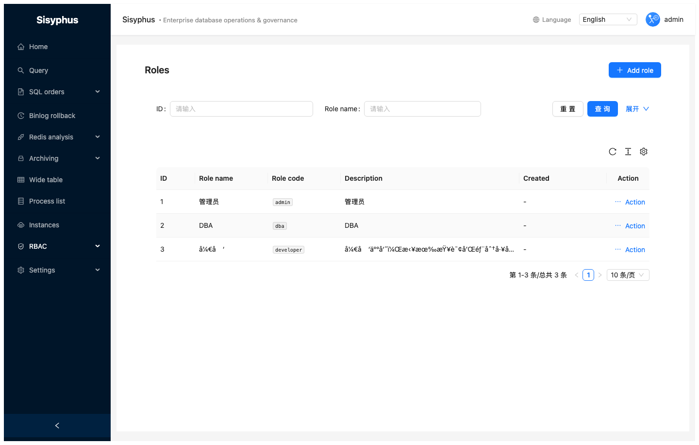</td>
  </tr>
</table>

> For step-by-step usage, see the [User Guide](docs/GUIDE.md). Screenshots are captured in **English** under `docs/screenshots/en/`. Regenerate with `npm run test:screenshots` in `e2e/` (writes both `en/` and `zh-CN/`).

---

## Contents

- [Why Sisyphus?](#why-sisyphus)
- [Features](#features)
- [Architecture](#architecture)
- [Prerequisites](#prerequisites)
- [Quick start](#quick-start)
- [Configuration](#configuration)
- [E2E tests](#e2e-tests)
- [API reference](docs/api.md)
- [User Guide](docs/GUIDE.md) · [中文手册](docs/GUIDE.zh-CN.md)
- [Quick start (detailed)](QUICKSTART.md) · [中文快速开始](QUICKSTART.zh-CN.md)
- [Deployment](#deployment)
- [Development](#development)
- [Contributing](CONTRIBUTING.md)

---

## Features

| Area | Highlights |
|------|------------|
| **SQL orders** | DDL/DML → goInception review → approval → execution; DDL supports gh-ost online schema change |
| **DML rollback** | Backup mode generates reverse SQL via goInception |
| **Query** | Monaco editor; MySQL / ClickHouse / Redis / HBase; history, favorites, export |
| **SQL advisor** | Suggestions and MyBatis XML generation |
| **Wide table** | Configurable JOINs; direct query and full sync to targets |
| **Instances** | CRUD, connectivity tests, metadata discovery |
| **RBAC** | Users, roles, permissions; JWT; **instance-scoped** query / DDL / DML / export (per user and per role) |
| **Archiving** | pt-archiver based jobs with cron |
| **Binlog rollback** | Parse binlog and build rollback workflows |
| **Redis** | Hot / large key analysis tasks |
| **Process list** | View and kill MySQL sessions |
| **Notifications** | WeCom / Feishu / DingTalk webhooks (configured in UI) |

---

## Architecture

```
sisyphus/
├── server/                   # Go backend (Kratos v2)
│   ├── cmd/sisyphus/
│   ├── internal/
│   │   ├── biz/
│   │   ├── data/             # GORM
│   │   ├── service/
│   │   └── conf/
│   ├── api/proto/v1/
│   └── configs/
├── web/                      # React (Umi 4 + Ant Design 5)
├── e2e/                      # Playwright
├── migrations/
├── scripts/
├── docs/
└── deploy/k8s/
```

**Request path**

```
Browser → Umi SPA (:8001)
            ↓ /api/v1/*
        Go HTTP server (:8000, Kratos)
            ↓
        biz → GORM → MySQL (app DB)
                 → Redis (Asynq)
                 → goInception (:4000)
                 → gh-ost (optional)
```

---

## Prerequisites

### Required

| Component | Version | Notes |
|-----------|---------|--------|
| Go | ≥ 1.21 | Backend |
| Node.js | ≥ 18 | Frontend |
| MySQL | ≥ 5.7 | App DB + Inception backup DB |
| Redis | ≥ 6 | Asynq |
| goInception | recent | SQL review & execution |

### Optional

| Component | Notes |
|-----------|--------|
| gh-ost | Large-table online DDL |
| pt-archiver | Archiving |

### goInception

```bash
# macOS
brew install goInception   # or releases: https://github.com/hanchuanchuan/goInception/releases

# Linux (example)
wget https://github.com/hanchuanchuan/goInception/releases/latest/download/goInception-linux-amd64.tar.gz
tar -zxvf goInception-linux-amd64.tar.gz
sudo mv goInception /usr/local/bin/

goInception --config=inception.cnf
```

Minimal `inception.cnf`:

```ini
[inception]
general_log = 1
enable_nullable = 0
check_primary_key = 1
check_column_comment = 0
```

### gh-ost (optional)

```bash
brew install gh-ost   # macOS
# Linux: https://github.com/github/gh-ost/releases
```

---

## Quick start

### 1. Clone

```bash
git clone <repo-url>
cd sisyphus
```

### 2. Database

```bash
mysql -u root -p -e "CREATE DATABASE sisyphus DEFAULT CHARACTER SET utf8mb4 COLLATE utf8mb4_unicode_ci;"
mysql -u root -p sisyphus < migrations/init.sql
mysql -u root -p sisyphus < migrations/test_data.sql   # optional dev data
```

### 3. Backend

```bash
cd server
go mod download
cp configs/config.yaml configs/config.local.yaml
# Edit config.local.yaml (MySQL, Redis, JWT, inception, …)

go run cmd/sisyphus/main.go -conf configs/config.local.yaml
# HTTP :8000
```

### 4. Frontend

```bash
cd web
npm install
npm start
# :8001
```

### 5. Login

Open [http://localhost:8001](http://localhost:8001):

| User | Password | Role |
|------|----------|------|
| `admin` | `Admin@123` | Super admin |
| `dba` | `Admin@123` | DBA |
| `developer` | `Admin@123` | Developer |

> Change default passwords and `jwt_secret` before production.

More detail: [QUICKSTART.md](QUICKSTART.md).

---

## Configuration

File: `server/configs/config.yaml`

```yaml
server:
  http:
    addr: 0.0.0.0:8000
    timeout: 5000000000
  grpc:
    addr: 0.0.0.0:9000
    timeout: 5000000000

data:
  database:
    driver: mysql
    source: root:password@tcp(127.0.0.1:3306)/sisyphus?charset=utf8mb4&parseTime=True&loc=Local
  redis:
    addr: 127.0.0.1:6379
    password: ""
    db: 0

auth:
  jwt_secret: your-secret-key-change-in-production
  jwt_expire: 86400

inception:
  host: 127.0.0.1
  port: 4000
  username: root
  password: ""
  backup_host: 127.0.0.1
  backup_port: 3306
  backup_username: root
  backup_password: "password"

ghost:
  socket_dir: /data/ghost/socket/
  log_dir: /data/ghost/log/
  panic_dir: /data/ghost/panic/
  binary_path: /usr/local/bin/gh-ost

tools:
  pt_archiver_path: /usr/local/bin/pt-archiver
  gh_ost_path: /usr/local/bin/gh-ost
```

Notification channels are stored in the database; configure them in **Settings → Notifications** after startup.

| Key | Meaning |
|-----|---------|
| `auth.jwt_secret` | Use a long random secret in production |
| `inception.backup_*` | Backup DB for DML rollback SQL |
| `ghost.*` | Paths for gh-ost when selected as DDL executor |

---

## E2E tests

[Playwright](https://playwright.dev/) — UI and API coverage.

| File | Scope |
|------|--------|
| `tests/01-auth.spec.ts` | Auth flows |
| `tests/02-instance.spec.ts` | Instances |
| `tests/03-sql-order.spec.ts` | Orders, approval, execution |
| `tests/04-query.spec.ts` | Query UI |
| `tests/05-permission.spec.ts` | RBAC UI |
| `tests/06-navigation.spec.ts` | Main routes |
| `tests/07-api.spec.ts` | API integration |
| `tests/08-docs-screenshots.spec.ts` | Screenshots (optional) |

```bash
cd e2e
npm install
npx playwright install chromium
npx playwright test
npm run test:screenshots   # writes ../docs/screenshots/en/ and ../docs/screenshots/zh-CN/
```

Requires backend `:8000`, frontend `:8001`, and seeded DB. Use Node ≥ 18.

---

## Deployment

### Docker Compose

```bash
docker-compose up -d
```

### Kubernetes

```bash
kubectl create namespace sisyphus
kubectl apply -f deploy/k8s/
kubectl get pods -n sisyphus
```

| Manifest | Purpose |
|----------|---------|
| `namespace.yaml` | Namespace |
| `server.yaml` | API / worker Deployment & Service |
| `web.yaml` | Frontend Deployment & Service |
| `ingress.yaml` | Ingress (if used) |
| `hpa.yaml` | HorizontalPodAutoscaler |
| `pdb.yaml` | PodDisruptionBudget |
| `network-policy.yaml` | NetworkPolicy |

Adjust images, secrets, and storage (e.g. shared volume for gh-ost) for your cluster.

### Production checklist

- [ ] Strong `jwt_secret`
- [ ] Change default admin password
- [ ] TLS (Ingress or reverse proxy)
- [ ] DB pool tuning
- [ ] Notification webhooks in UI
- [ ] Inception backup user with write access
- [ ] gh-ost privileges if used (`REPLICATION SLAVE`, etc.)

---

## Development

### Backend

```bash
cd server
go mod download
go install github.com/google/wire/cmd/wire@latest
cd cmd/sisyphus && go generate .    # or: wire
make api                            # protobuf
go test ./...
go build -o bin/sisyphus cmd/sisyphus/main.go
```

### Frontend

```bash
cd web
npm install
npm start
npm run build
npm run lint
```

### New API (typical)

1. Add proto under `api/proto/v1/`
2. `make api`
3. Implement `internal/service/`, `internal/biz/`, `internal/data/`
4. Register wiring in `cmd/sisyphus/wire.go` and regenerate Wire

---

## License

[MIT License](LICENSE)
