# Sisyphus

> **企业级智能数据库运维与管控平台**

> **开发说明：** 本项目大量代码由 **[Claude Code](https://claude.com/claude-code)** 与 **[Cursor](https://cursor.com)** 辅助编写与迭代；安全、合规与上线决策仍由维护者负责。
>
> 基于 Go (Kratos v2) + React (Umi 4 + Ant Design 5) 构建，整合 SQL 工单审批、多引擎数据查询、宽表服务、权限管控、数据归档、Binlog 回滚于一体。

[](LICENSE)
[](https://golang.org/)
[](https://nodejs.org/)

**语言 / Languages:** [English](README.md) | **简体中文**（本文）

**自动化：** [GitHub Actions](.github/workflows/) — `ci.yml`（按路径触发后端/前端检查）、`e2e.yml`（Playwright）、`docker-base.yml` / `docker.yml`（镜像构建与发布）。安全漏洞说明见 [SECURITY.md](SECURITY.md)。

---

## 为何名为 Sisyphus？

希腊神话中，**西西弗斯**（Σίσυφος / Sisyphus）是科林斯国王，因戏弄冥界与众神，被罚在冥界永无止境地推一块巨石上山；快到山顶时石头滚落，他必须走回山脚，**再推一次**，循环不息。后世常借此比喻看似徒劳却必须重复的劳作；加缪在《西西弗神话》中则强调在荒诞中仍要认真生活。

对数据库与平台工程来说，这个意象很直白：**运维与数据治理本身就是「推石上山」**——版本发布、表结构变更、数据订正、备份与归档、故障与复盘，一轮接一轮，并不会因为上一次做完就彻底消失。

**Sisyphus** 本项目并不宣称能终结这种循环，而是为每一次循环补上 **轨道与保险**：SQL 工单与多级审批、goInception 审核与 gh-ost 在线 DDL、DML 备份与 Binlog 回滚、定时归档与异步任务（Asynq）、RBAC 与实例权限。石头还会再来，但希望每一次推举都更 **可审计、可重复、可撤回**。

---

## 功能截图

与 [使用手册](docs/GUIDE.zh-CN.md) 插图一致，以下为各核心模块界面（两列拼图）。

<table>
  <tr>
    <td align="center" width="50%"><b>登录页</b></td>
    <td align="center" width="50%"><b>首页仪表盘</b></td>
  </tr>
  <tr>
    <td>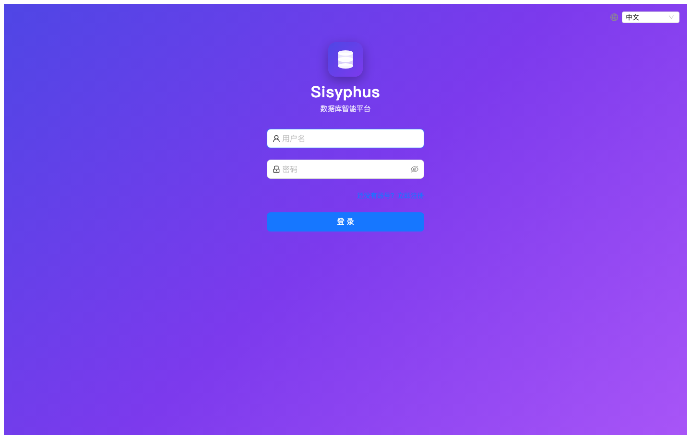</td>
    <td>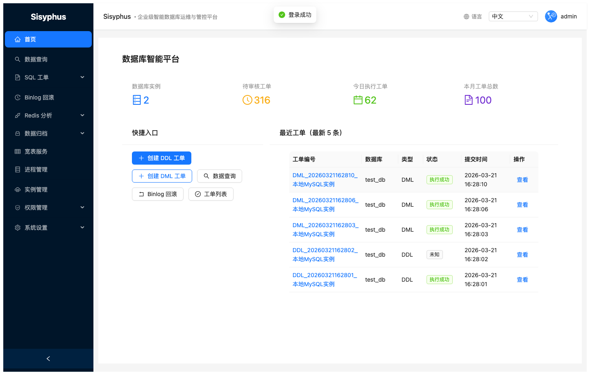</td>
  </tr>
  <tr>
    <td align="center"><b>实例管理</b></td>
    <td align="center"><b>SQL 工单列表</b></td>
  </tr>
  <tr>
    <td>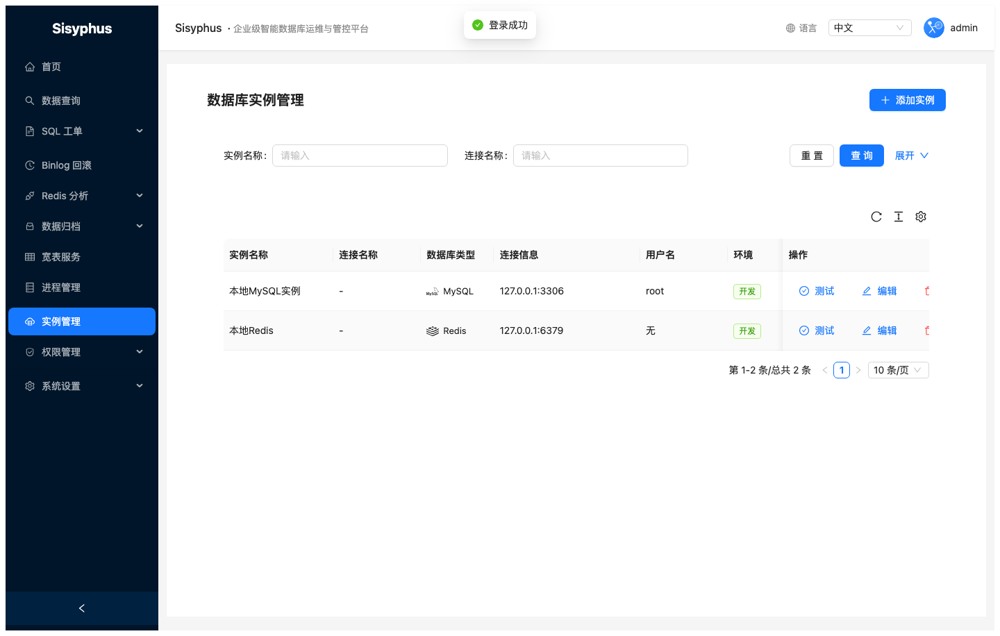</td>
    <td>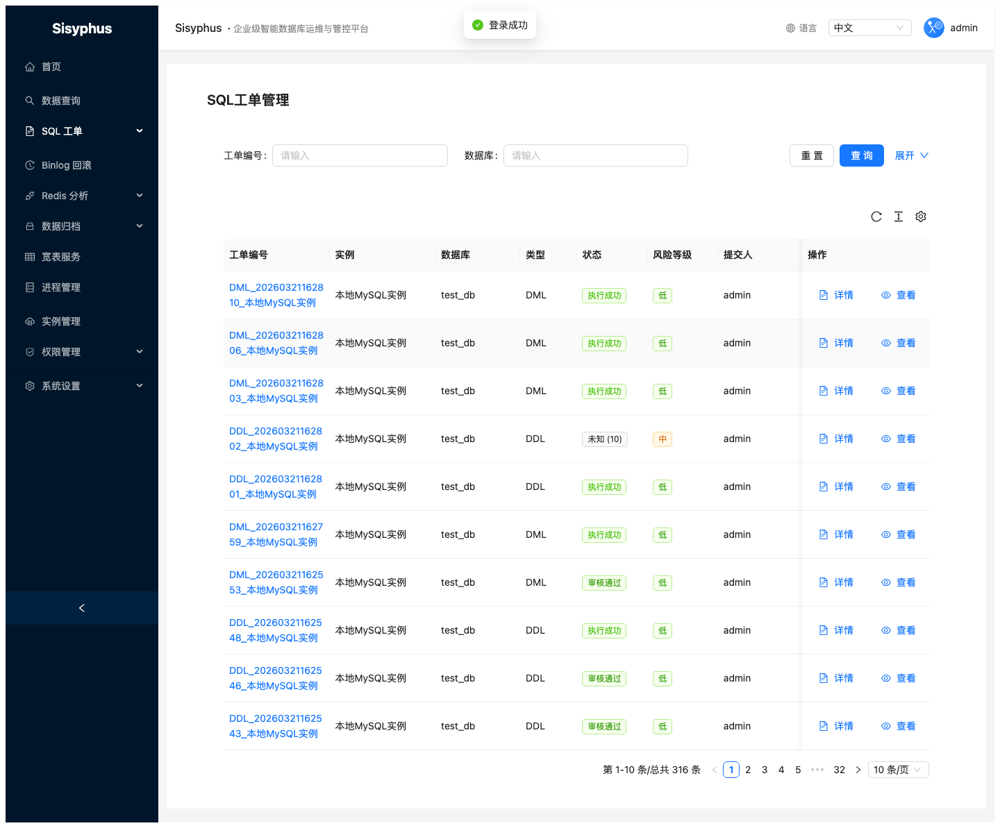</td>
  </tr>
  <tr>
    <td align="center"><b>创建 DDL 工单</b></td>
    <td align="center"><b>创建 DML 工单</b></td>
  </tr>
  <tr>
    <td></td>
    <td>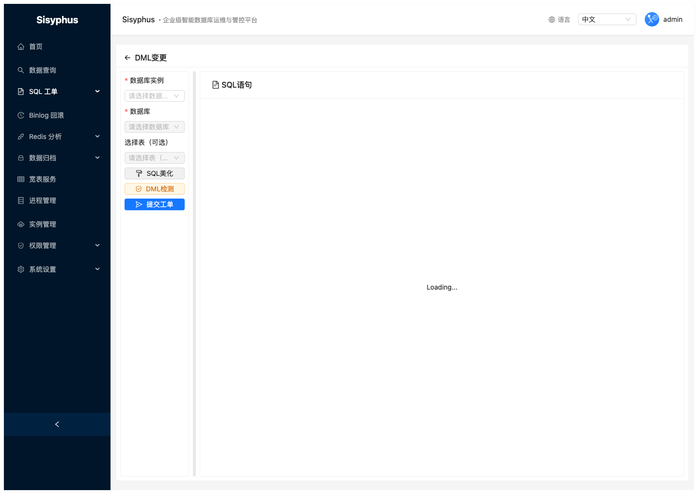</td>
  </tr>
  <tr>
    <td align="center"><b>数据查询（Monaco）</b></td>
    <td align="center"><b>表结构查看</b></td>
  </tr>
  <tr>
    <td>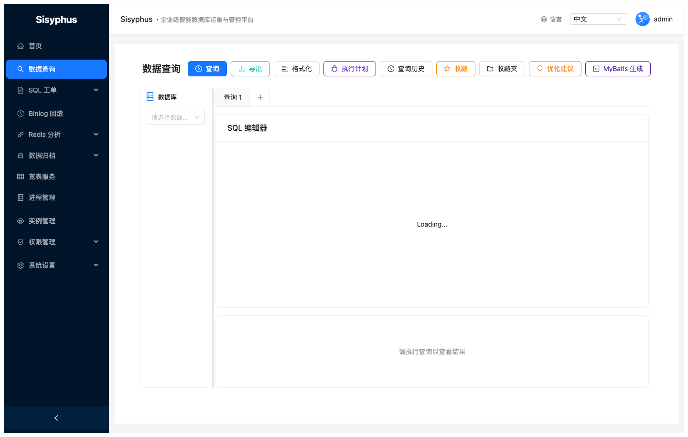</td>
    <td>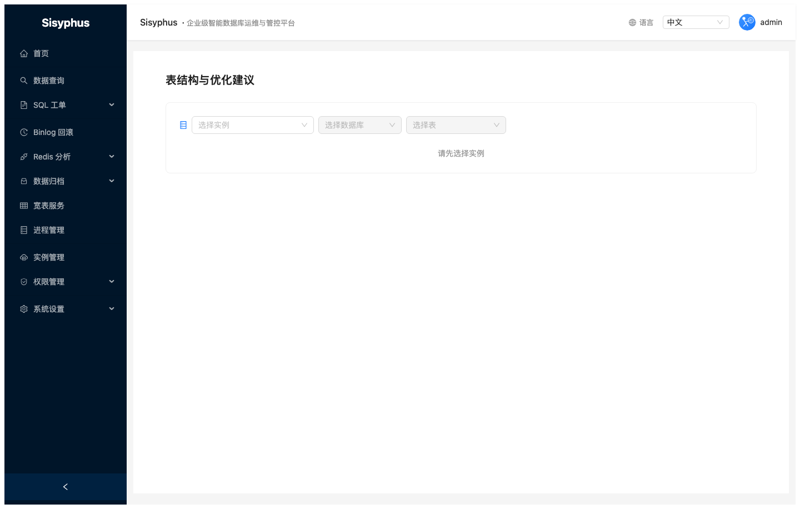</td>
  </tr>
  <tr>
    <td align="center"><b>进程管理</b></td>
    <td align="center"><b>Binlog 回滚</b></td>
  </tr>
  <tr>
    <td>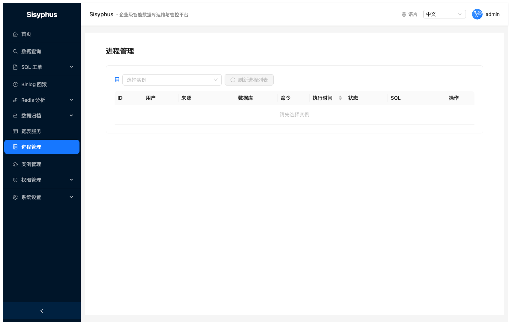</td>
    <td>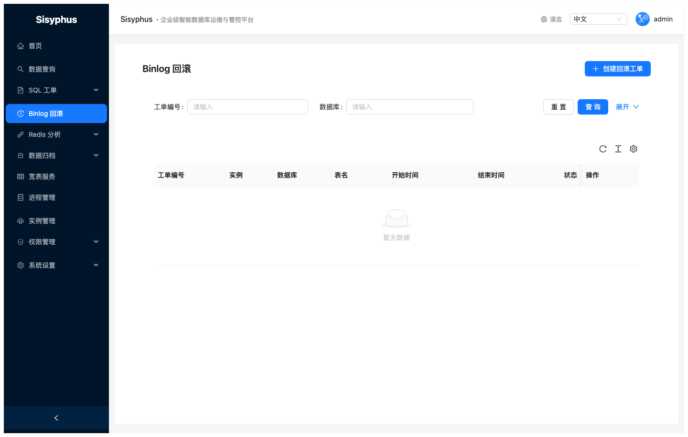</td>
  </tr>
  <tr>
    <td align="center"><b>Redis 分析任务</b></td>
    <td align="center"><b>数据归档配置</b></td>
  </tr>
  <tr>
    <td>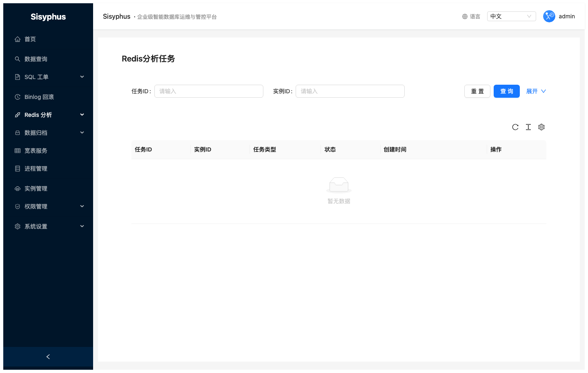</td>
    <td>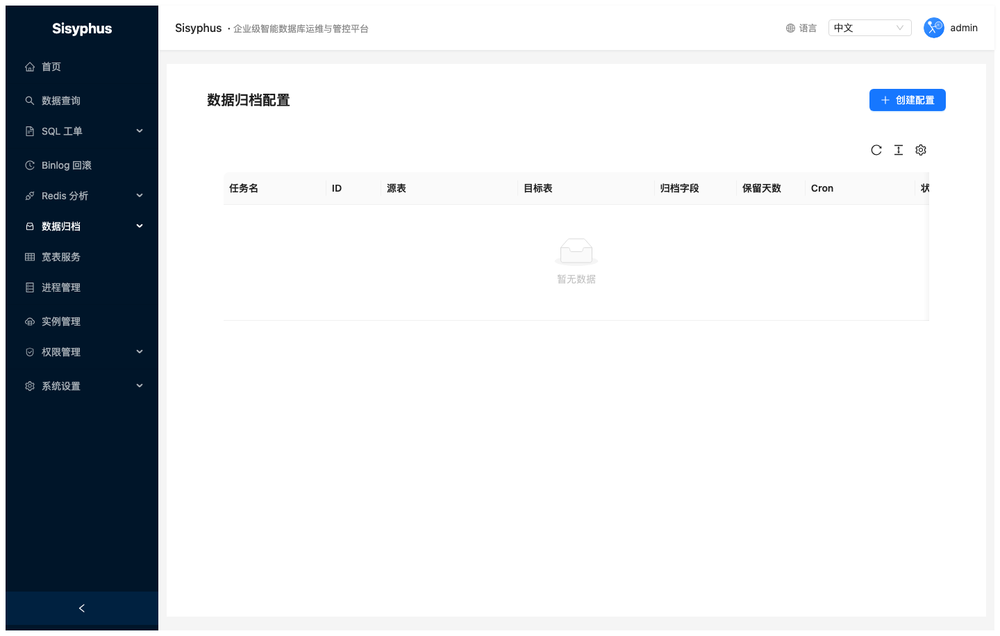</td>
  </tr>
  <tr>
    <td align="center" colspan="2"><b>宽表服务</b></td>
  </tr>
  <tr>
    <td colspan="2">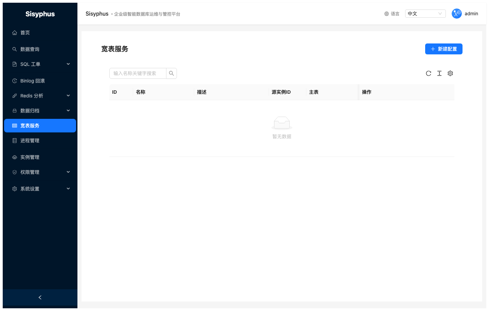</td>
  </tr>
  <tr>
    <td align="center"><b>权限 — 用户管理</b></td>
    <td align="center"><b>权限 — 角色管理</b></td>
  </tr>
  <tr>
    <td>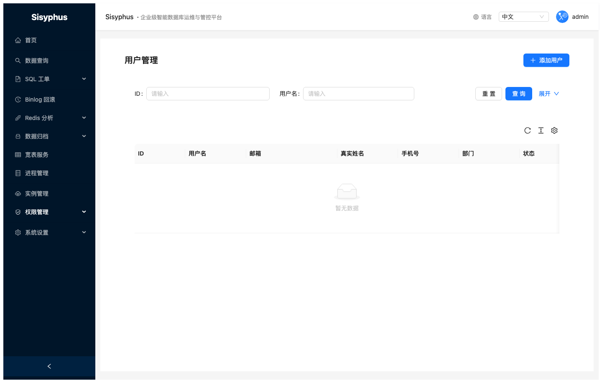</td>
    <td>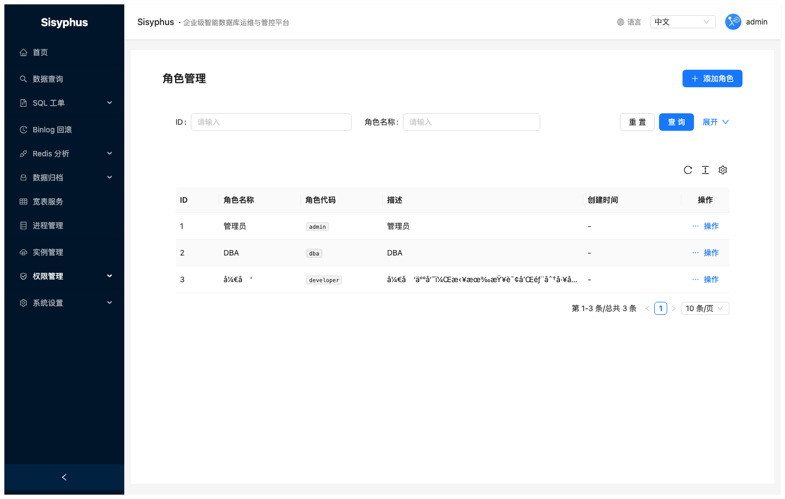</td>
  </tr>
</table>

> 各模块操作步骤与说明见 [使用手册](docs/GUIDE.zh-CN.md)。中文截图位于 `docs/screenshots/zh-CN/`（英文版见 `docs/screenshots/en/`）。在 `e2e/` 下执行 `npm run test:screenshots` 可一次性重新生成两套语言截图。

---

## 目录

- [为何名为 Sisyphus](#为何名为-sisyphus)
- [功能特性](#功能特性)
- [架构概览](#架构概览)
- [环境依赖](#环境依赖)
- [快速开始](#快速开始)
- [详细快速开始](QUICKSTART.zh-CN.md) · [English Quick Start](QUICKSTART.md)
- [配置说明](#配置说明)
- [E2E 自动化测试](#e2e-自动化测试)
- [API 文档](docs/api.md)
- [使用手册](docs/GUIDE.zh-CN.md) · [English User Guide](docs/GUIDE.md)
- [部署](#部署)
- [开发指南](#开发指南)
- [贡献指南](CONTRIBUTING.md)

---

## 功能特性

| 模块 | 功能亮点 |
|------|----------|
| **SQL 工单** | DDL/DML 工单提交 → goInception 语法审核 → 多级审批 → 执行；DDL 支持 gh-ost 无锁在线变更 |
| **DML 备份回滚** | goInception 备份模式自动生成反向 UPDATE/DELETE 回滚 SQL，变更可逆 |
| **数据查询** | Monaco 编辑器 + 多引擎（MySQL/ClickHouse/Redis/HBase），SQL 智能补全，结果导出，历史 & 收藏 |
| **SQL 优化建议** | 一键分析当前 SQL，结合表结构给出索引优化、写法改进等建议，支持 MyBatis XML 生成 |
| **宽表服务** | 多表 JOIN 配置化，支持 direct 直连查询、全量同步至目标实例 |
| **实例管理** | MySQL/Redis/ClickHouse/HBase 实例 CRUD，在线连接测试，数据库/表/列枚举 |
| **权限管理** | RBAC 用户-角色-权限；JWT；**按实例**配置查询 / DDL / DML / 导出（支持角色与用户直授） |
| **数据归档** | pt-archiver 定时数据归档，支持条件过滤和跨实例迁移 |
| **Binlog 回滚** | MySQL Binlog 解析，按时间范围生成回滚工单 |
| **Redis 分析** | 热 Key / 大 Key 扫描分析任务管理 |
| **进程管理** | 查看并 Kill 数据库进程列表 |
| **通知** | 企业微信 / 飞书 / 钉钉机器人工单状态通知，可在前端页面配置 |

---

## 架构概览

```
sisyphus/
├── server/                   # Go 后端 (go-kratos v2)
│   ├── cmd/sisyphus/          # 程序入口
│   ├── internal/
│   │   ├── biz/               # 业务逻辑层
│   │   ├── data/              # 数据访问层 (GORM)
│   │   ├── service/           # gRPC/HTTP handler
│   │   └── conf/              # 配置结构体
│   ├── api/proto/v1/          # Protobuf 定义 & 生成代码
│   └── configs/               # 配置文件
├── web/                  # React 前端 (UmiJS 4 + Ant Design 5)
│   └── src/
│       ├── pages/             # 页面组件 (18+ 模块)
│       ├── services/          # API 请求层
│       └── components/        # 公共组件
├── e2e/                       # Playwright 端到端测试
├── migrations/                # 数据库初始化 & 迁移 SQL
├── scripts/                   # 运维辅助脚本
├── docs/                      # 文档 & 截图
└── deploy/k8s/                # Kubernetes 部署配置
```

**请求链路**

```
浏览器 → UmiJS SPA (port 8001)
            ↓ /api/v1/*
        Go HTTP Server (port 8000, Kratos)
            ↓
        biz 层 → GORM → MySQL (sisyphus 库)
                      → Redis (Asynq 任务队列)
                      → goInception (SQL 审核/执行, port 4000)
                      → gh-ost (大表在线 DDL)
```

---

## 环境依赖

### 必须

| 组件 | 版本 | 说明 |
|------|------|------|
| Go | ≥ 1.21 | 后端编译运行 |
| Node.js | ≥ 18 | 前端构建 |
| MySQL | ≥ 5.7 | 业务数据库 & goInception 备份库 |
| Redis | ≥ 6 | Asynq 任务队列 |
| goInception | 最新版 | SQL 审核与执行引擎 |

### 可选

| 组件 | 说明 |
|------|------|
| gh-ost | 大表在线 DDL（无锁变更） |
| pt-archiver | 数据归档 |

### 安装 goInception

```bash
# macOS
brew install goInception   # 或从 https://github.com/hanchuanchuan/goInception/releases 下载

# Linux
wget https://github.com/hanchuanchuan/goInception/releases/latest/download/goInception-linux-amd64.tar.gz
tar -zxvf goInception-linux-amd64.tar.gz
sudo mv goInception /usr/local/bin/

# 启动（默认监听 4000 端口）
goInception --config=inception.cnf
```

`inception.cnf` 最小配置：

```ini
[inception]
general_log = 1
enable_nullable = 0
check_primary_key = 1
check_column_comment = 0
```

### 安装 gh-ost（可选）

```bash
# macOS
brew install gh-ost

# Linux
wget https://github.com/github/gh-ost/releases/latest/download/gh-ost-binary-linux-amd64-*.tar.gz
tar -zxvf gh-ost-*.tar.gz
sudo mv gh-ost /usr/local/bin/
```

---

## 快速开始

### 1. 克隆仓库

```bash
git clone <repo-url>
cd sisyphus
```

### 2. 初始化数据库

```bash
# 创建数据库并导入表结构
mysql -u root -p -e "CREATE DATABASE sisyphus DEFAULT CHARACTER SET utf8mb4 COLLATE utf8mb4_unicode_ci;"
mysql -u root -p sisyphus < migrations/init.sql

# 导入测试数据（开发环境可选）
mysql -u root -p sisyphus < migrations/test_data.sql
```

### 3. 启动后端

```bash
cd server

# 下载依赖
go mod download

# 复制并修改配置（见"配置说明"）
cp configs/config.yaml configs/config.local.yaml
# 编辑 config.local.yaml 填写正确的数据库/Redis 连接

# 运行
go run cmd/sisyphus/main.go -conf configs/config.local.yaml
# 后端监听 http://localhost:8000
```

### 4. 启动前端

```bash
cd web
npm install
npm start
# 前端监听 http://localhost:8001
```

### 5. 登录

访问 [http://localhost:8001](http://localhost:8001)，使用默认账号登录：

| 账号 | 密码 | 角色 |
|------|------|------|
| `admin` | `Admin@123` | 超级管理员 |
| `dba` | `Admin@123` | DBA |
| `developer` | `Admin@123` | 开发者 |

> **生产环境请立即修改默认密码和 JWT 密钥！**

---

## 配置说明

配置文件路径：`server/configs/config.yaml`

```yaml
server:
  http:
    addr: 0.0.0.0:8000
    timeout: 5000000000       # 5 秒（单位：纳秒）
  grpc:
    addr: 0.0.0.0:9000
    timeout: 5000000000

data:
  database:
    driver: mysql
    source: root:password@tcp(127.0.0.1:3306)/sisyphus?charset=utf8mb4&parseTime=True&loc=Local
  redis:
    addr: 127.0.0.1:6379
    password: ""
    db: 0

auth:
  jwt_secret: your-secret-key-change-in-production   # 生产必改
  jwt_expire: 86400                                   # token 有效期（秒），默认 24h

# goInception 连接配置
inception:
  host: 127.0.0.1
  port: 4000
  username: root
  password: ""
  backup_host: 127.0.0.1
  backup_port: 3306
  backup_username: root
  backup_password: "password"

# gh-ost 配置（可选）
ghost:
  socket_dir: /data/ghost/socket/
  log_dir: /data/ghost/log/
  panic_dir: /data/ghost/panic/
  binary_path: /usr/local/bin/gh-ost

# 通知渠道配置已迁移至数据库
# 启动后在前端「系统设置 → 通知配置」页面配置企业微信 / 飞书 / 钉钉 Webhook

tools:
  pt_archiver_path: /usr/local/bin/pt-archiver
  gh_ost_path: /usr/local/bin/gh-ost
```

### 关键配置项说明

| 配置项 | 说明 |
|--------|------|
| `auth.jwt_secret` | JWT 签名密钥，**生产环境必须使用 32+ 位随机字符串** |
| `inception.backup_host/port` | goInception 备份库地址，DML 工单开启备份时写入回滚 SQL |
| `ghost.binary_path` | gh-ost 二进制路径，DDL 工单选择 gh-ost 执行方式时使用 |

---

## E2E 自动化测试

使用 [Playwright](https://playwright.dev/) 编写，覆盖 UI 交互和 API 接口两个维度。

### 测试文件说明

| 文件 | 覆盖范围 |
|------|---------|
| `tests/01-auth.spec.ts` | 登录/登出、错误密码、未登录跳转 |
| `tests/02-instance.spec.ts` | 实例列表、新增表单、连接测试 |
| `tests/03-sql-order.spec.ts` | 工单列表、DDL 创建与审核、审批、执行、DML 回滚查看 |
| `tests/04-query.spec.ts` | SQL 编辑器加载、执行查询、历史记录、收藏夹 |
| `tests/05-permission.spec.ts` | 用户/角色/权限列表加载，创建角色表单 |
| `tests/06-navigation.spec.ts` | 侧边栏导航、11 个主要页面无错误加载 |
| `tests/07-api.spec.ts` | 完整 API 测试：认证、实例、工单生命周期、DDL/DML 端到端 |
| `tests/08-docs-screenshots.spec.ts` | 文档截图（默认跳过，见下方 `npm run test:screenshots`） |

### 安装与运行

```bash
cd e2e
npm install
npx playwright install chromium

# 运行所有测试
npx playwright test

# 更新 README / 手册截图（需前后端与库已就绪，写入 ../docs/screenshots/en/ 与 zh-CN/）
npm run test:screenshots

# 只运行 API 测试
npx playwright test tests/07-api.spec.ts

# 带界面运行（交互调试）
npx playwright test --headed

# 查看 HTML 报告
npx playwright show-report
```

### 前置条件

- 后端运行在 `http://localhost:8000`
- 前端运行在 `http://localhost:8001`
- MySQL 实例 ID=1 存在且连通，`test_db` 库含 `test_orders` 表
- 运行 Playwright 的机器需 **Node.js ≥ 18**；若终端默认 Node 过旧（如 v12），请用 `nvm use 18`（或 20+）后再执行 `npx playwright test`

部分用例会在没有「已成功且含备份的 DML 工单」等数据时 **条件跳过**（例如回滚 SQL 列表断言），属预期行为。

---

## 部署

### Docker Compose（推荐开发/测试）

```bash
docker-compose up -d
```

`docker-compose.yml` 会启动：MySQL、Redis、goInception、后端、前端。

### Kubernetes

```bash
# 创建命名空间
kubectl create namespace sisyphus

# 应用所有配置
kubectl apply -f deploy/k8s/

# 查看状态
kubectl get pods -n sisyphus
```

| 文件 | 说明 |
|------|------|
| `deploy/k8s/namespace.yaml` | 命名空间 |
| `deploy/k8s/server.yaml` | 后端 Deployment + Service |
| `deploy/k8s/web.yaml` | 前端 Deployment + Service |
| `deploy/k8s/ingress.yaml` | Ingress（如使用） |
| `deploy/k8s/hpa.yaml` | 水平扩缩容 |
| `deploy/k8s/pdb.yaml` | Pod 中断预算 |
| `deploy/k8s/network-policy.yaml` | 网络策略 |

### 生产环境 Checklist

- [ ] 修改 `auth.jwt_secret` 为 32+ 位随机字符串
- [ ] 修改默认 `admin` 密码
- [ ] 配置 HTTPS（Ingress TLS 或 Nginx 代理）
- [ ] 设置数据库连接池参数
- [ ] 在前端「系统设置 → 通知配置」页面配置企业微信 / 飞书 / 钉钉 Webhook
- [ ] 确认 goInception 备份库账号有写权限
- [ ] 确认 gh-ost 账号有 REPLICATION SLAVE 权限（如使用 gh-ost）

---

## 开发指南

### 后端

```bash
cd server

# 下载依赖
go mod download

# 生成 Wire 依赖注入代码
go install github.com/google/wire/cmd/wire@latest
wire gen ./cmd/sisyphus

# 重新生成 Protobuf 代码
make api

# 运行测试
go test ./...

# 构建二进制
go build -o bin/sisyphus cmd/sisyphus/main.go
```

### 前端

```bash
cd web

npm install
npm start        # 开发服务器 http://localhost:8001
npm run build    # 生产构建
npm run lint     # ESLint 检查
```

### 新增 API 接口流程

1. 在 `api/proto/v1/` 中添加 proto 定义
2. 运行 `make api` 重新生成 pb.go
3. 在 `internal/service/` 实现 Handler
4. 在 `internal/biz/` 实现业务逻辑
5. 在 `internal/data/` 实现数据访问
6. 在 `cmd/sisyphus/wire.go` 中注册依赖

---

## 许可证

[MIT License](LICENSE)
