# Sisyphus User Guide

> How to use the main features of Sisyphus, with UI screenshots.

**Languages:** **English** (this page) | [简体中文](GUIDE.zh-CN.md)

---

## Contents

- [Login & first steps](#login--first-steps)
- [Dashboard](#dashboard)
- [Instances](#instances)
- [SQL orders](#sql-orders)
- [Data query](#data-query)
- [Table structure](#table-structure)
- [Process list](#process-list)
- [Binlog rollback](#binlog-rollback)
- [Redis analysis](#redis-analysis)
- [Data archiving](#data-archiving)
- [Wide table](#wide-table)
- [RBAC](#rbac)

---

## Login & first steps

Open `http://localhost:8001` and sign in with a seeded account:

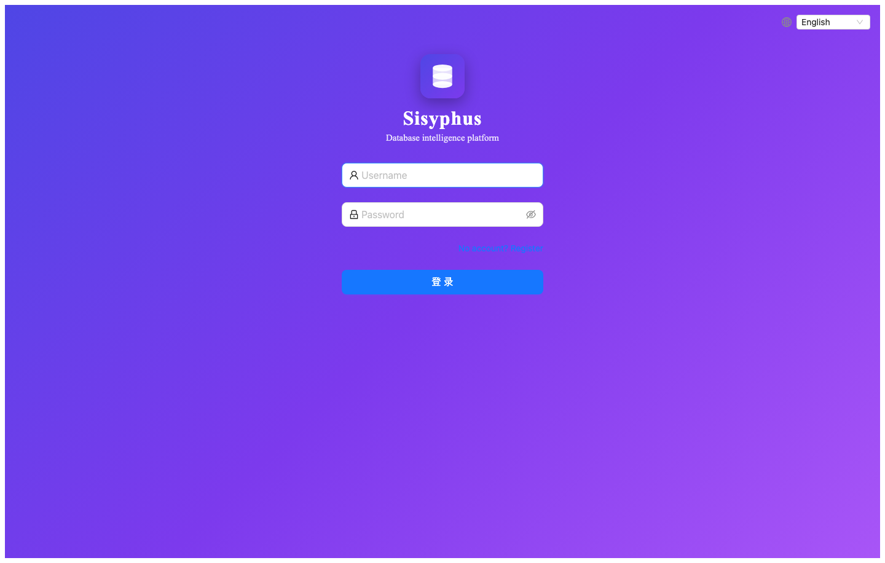

| User | Password | Role |
|------|----------|------|
| `admin` | `Admin@123` | Full access |
| `dba` | `Admin@123` | DBA: instances & approvals |
| `developer` | `Admin@123` | Submit orders & query |

> In production, change default passwords immediately under **Permission → Users**.

---

## Dashboard

After login you see the home dashboard:

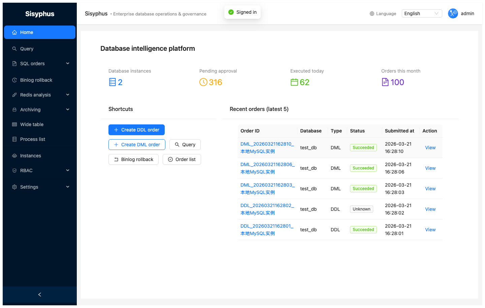

- Pending approvals, today’s executions
- Recent order activity
- Shortcuts to main modules

---

## Instances

Open **Instances** in the sidebar:

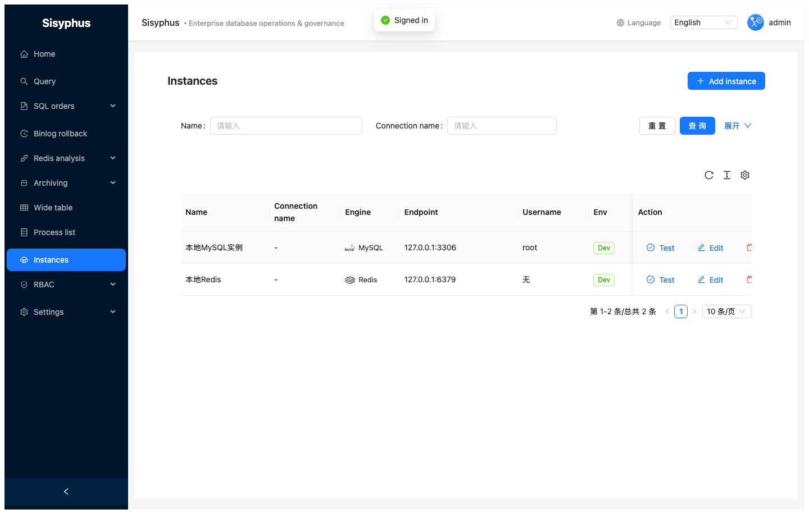

### Add instance

1. Click **+ Add instance**
2. Fill in:

| Field | Description |
|-------|-------------|
| Name | Display name for orders and query |
| Connection name | Optional identifier |
| DB type | MySQL / Redis / ClickHouse / HBase |
| Host / port | Network endpoint |
| Username / password | Credentials |
| Environment | dev / test / prod |

3. **Test** connectivity, then **Save**

> For MySQL, the account typically needs `SELECT, INSERT, UPDATE, DELETE, CREATE, DROP, ALTER, INDEX, REPLICATION SLAVE` depending on features; DML backup needs write access to the backup database.

---

## SQL orders

SQL orders support DDL and DML. All statements go through **goInception** review before execution.

**Lifecycle**

```
Submitted (pending) → Approved → Executing → Success
                  ↓              → Failed
               Rejected
```

### Order list

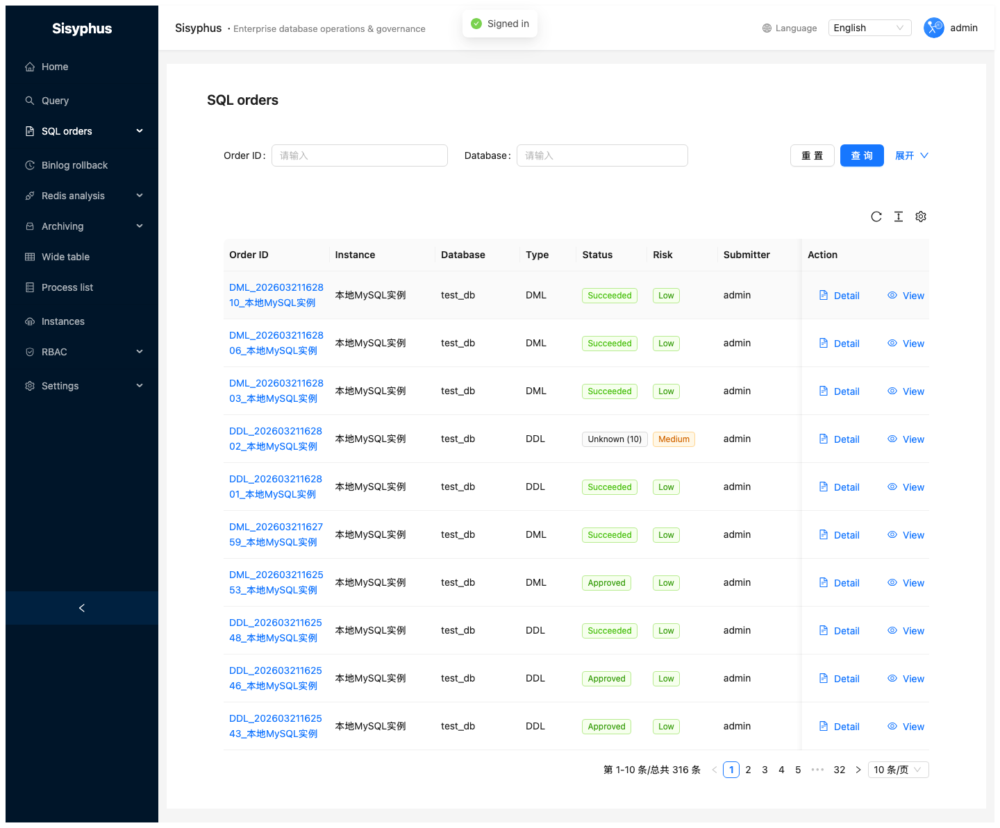

Filter by id, database, status, type. Each row shows instance, type, status, risk, submitter.

### Create DDL order

**SQL orders → Create DDL order**:

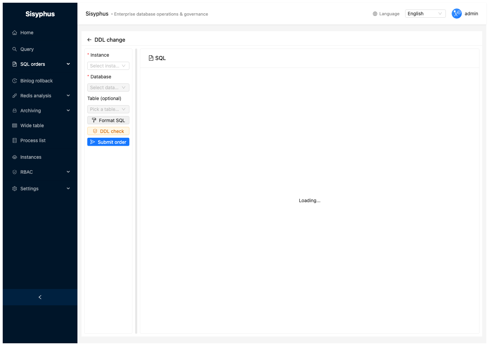

1. Choose instance and database  
2. Enter DDL in Monaco  
3. **Review** — wait for goInception result  
4. Choose executor: **goInception** or **gh-ost** (large tables)  
5. Add remark  
6. **Submit**

### Create DML order

**SQL orders → Create DML order**:


1. Choose instance and database  
2. Enter DML (`INSERT` / `UPDATE` / `DELETE`)  
3. Enable **backup** (recommended) for rollback SQL  
4. **Review** → **Submit**

> With backup enabled, after success the order detail shows **Rollback SQL** for reverse statements and one-click rollback order creation.

### Approve & execute

On the order detail page:

- **Approve / Reject** (DBA)  
- **Execute** after approval  
- **Rollback SQL** for successful DML with backup  

---

## Data query

Open **Data query**:

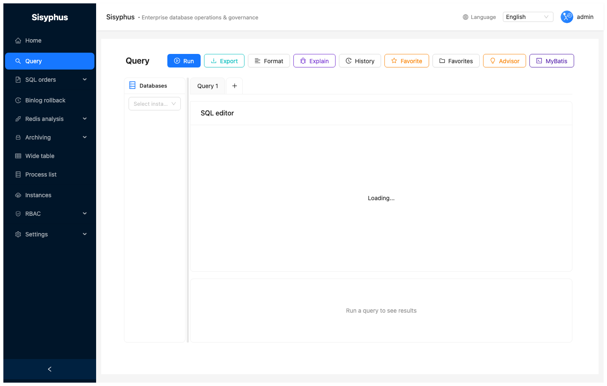

| Feature | Description |
|---------|-------------|
| Instance / DB | Left panel tree |
| Monaco editor | Highlighting, completion, tabs |
| Run | Button or `Ctrl+Enter` |
| History | Last executions |
| Favorites | Save / manage SQL |
| Explain | Execution plan |
| Advisor | Index / rewrite hints |
| Export | Excel / CSV / JSON |
| MyBatis | Generate XML from DDL |

Use **+** on the tab bar for multiple concurrent queries.

---

## Table structure

**Tools → Table structure**:

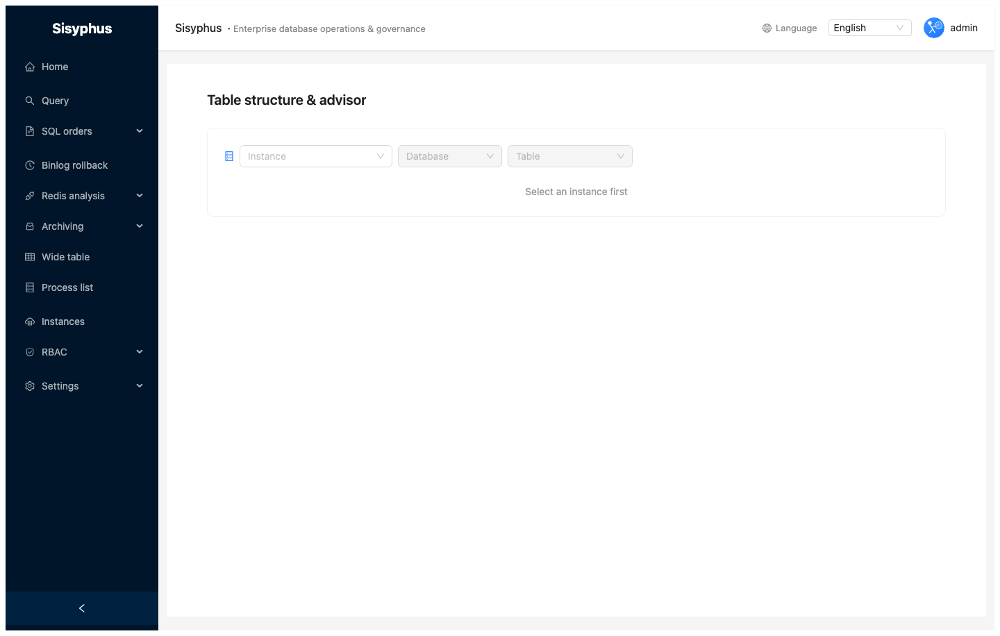

Pick instance and database to see column metadata and `SHOW CREATE TABLE` style DDL.

---

## Process list

**Process list**:

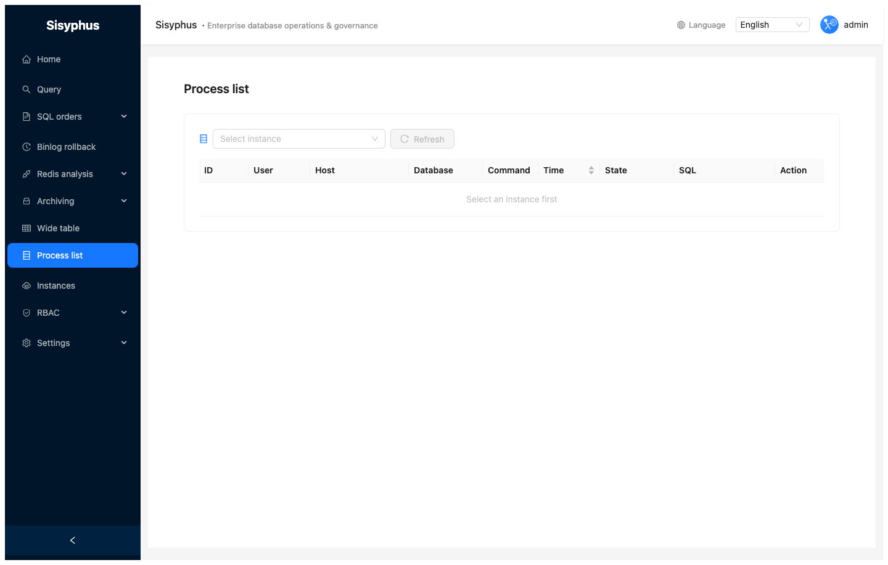

Lists active sessions for a MySQL instance; **Kill** requires permission.

---

## Binlog rollback

**Binlog rollback**:

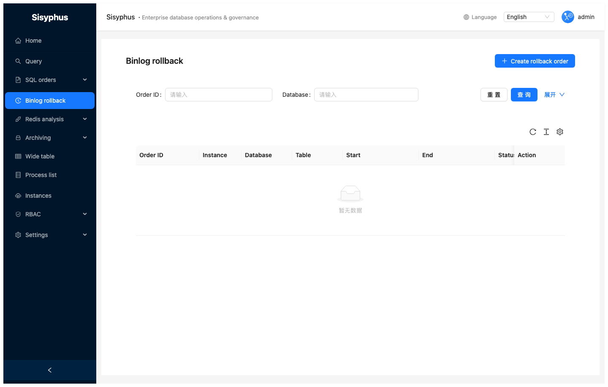

1. Choose MySQL instance  
2. Time range  
3. Optional DB / table filter  
4. Operation type (INSERT / UPDATE / DELETE)  
5. **Analyze** → review rollback SQL  
6. **Create rollback order** to open a DML workflow  

Useful for recovering from mistaken DML using binlog.

---

## Redis analysis

**Redis analysis** — hot keys and large keys:

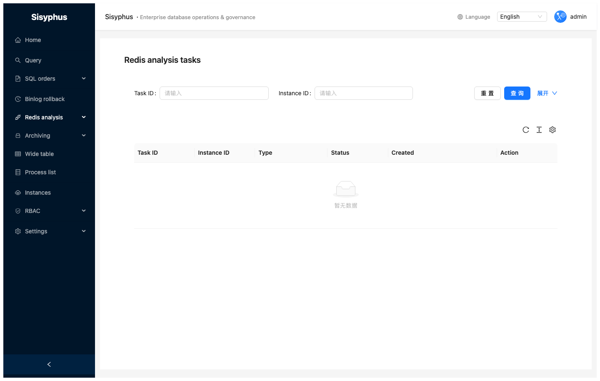

### Hot keys

Scans high-frequency keys in a time window.

### Large keys

Scans memory-heavy keys.

**Steps:** select instance → **Create task** → wait for results.

---

## Data archiving

**Archiving → Configs**:

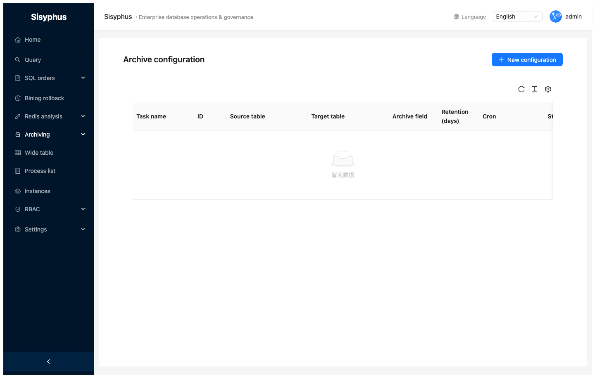

| Field | Description |
|-------|-------------|
| Task name | Label |
| Source instance / DB / table | Origin |
| Target instance (optional) | Omit for delete-only; set for migrate |
| Archive field | Time column (e.g. `created_at`) |
| Retention days | Keep recent N days |
| Extra condition | Optional `WHERE` |
| Cron | e.g. `0 2 * * *` daily at 02:00 |

Uses **pt-archiver** under the hood.

---

## Wide table

**Wide table**:

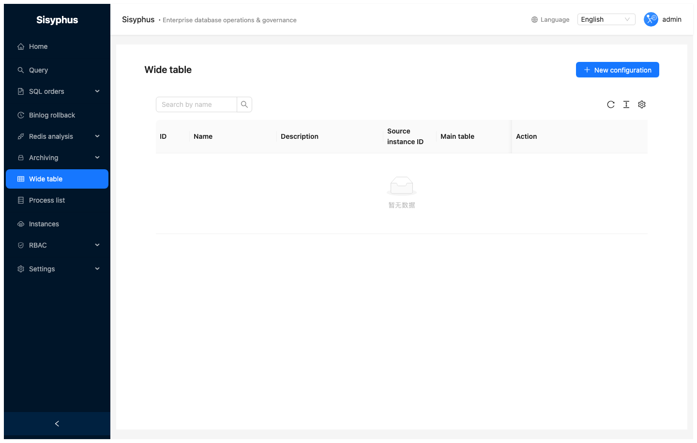

- Configure JOIN rules (main table, joined tables, `ON`)  
- Field mapping  
- Run queries in the UI  
- Optional full sync to a target table  

### Create configuration

1. Name and description  
2. Source instance, database, main table  
3. JOIN definitions  
4. Field mappings  
5. Optional `WHERE` for sync  
6. Optional target instance / DB / table  

---

## RBAC

**Permission** — users, roles, permissions:

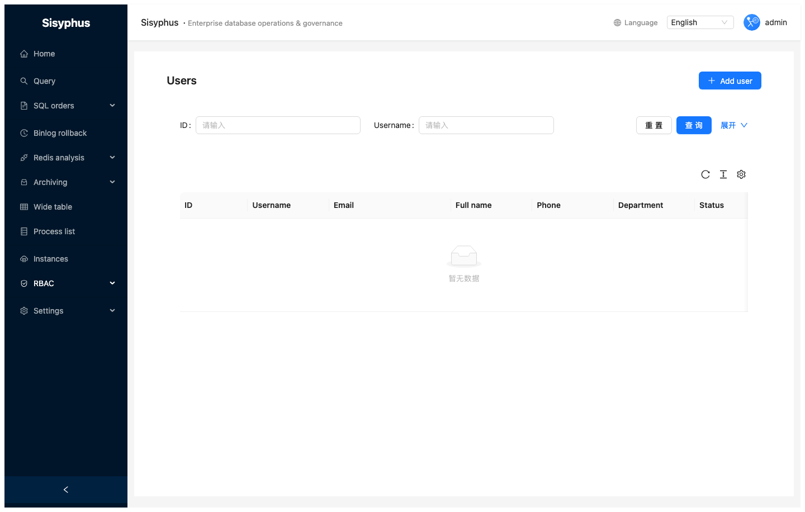
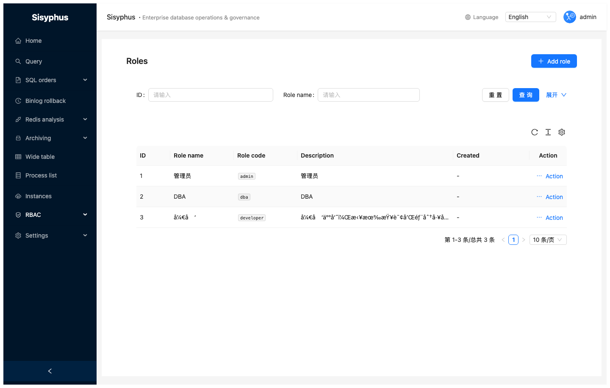

### Model

```
User → Role → Permission
```

### Built-in roles

| Role | Code | Notes |
|------|------|-------|
| Super admin | `admin` | All permissions |
| DBA | `dba` | Approve & execute |
| Developer | `developer` | Submit & query |

### Users

Create user, assign roles, enable/disable, reset password.

### Roles

Create role, **Configure permissions** on the permission tree.

### Instance access (query / DDL / DML / export)

Besides global permission points (e.g. `sql_query:execute`, `sql_order:create`), you can restrict **which database instances** a principal may use and for **which capabilities**:

| Scope | Typical use |
|-------|-------------|
| `query` | Data query (all engines), process list, table structure, metadata APIs that back the query UI |
| `ddl` | SQL orders of type DDL, related Inception review on that instance |
| `dml` | SQL orders of type DML (and export-type orders use `export`) |
| `export` | Downloading query results (Excel / CSV / JSON / INSERT SQL) |

**Where to configure**

- **Permission → Users → Instances** — direct grants for one user (stored in `sisyphus_user_instance_permissions`).
- **Permission → Roles → Instance access** (role action menu) — grants for every user who has that role (`sisyphus_role_instance_permissions`).

**Effective access** for a user is the **union** of all grants from their roles **plus** any direct user grants. Users with the **`instance:manage`** permission are not restricted by these rows.

**Default:** If a user has **no** instance-scope rows (direct or via any role), the platform does **not** apply extra instance filtering. After you assign scopes, only listed instances and capabilities apply.

**API:** `GET/PUT /api/v1/users/{id}/instance-permissions`, `GET/PUT /api/v1/roles/{id}/instance-permissions`. Instance list supports `instance_permission_scope` (`query` \| `ddl` \| `dml` \| `export`) to filter dropdowns.

---

## Appendix: refreshing screenshots

English guide images live in `docs/screenshots/en/`. The Chinese guide uses `docs/screenshots/zh-CN/`. Regenerate both with Playwright when the UI changes. Prerequisites: backend `:8000`, frontend `:8001`, DB seeded like E2E (e.g. `admin` / `Admin@123`). See the root [README](../README.md) section **E2E tests**.

```bash
cd e2e
npm install && npx playwright install chromium
npm run test:screenshots
```

Commit updated PNGs with your doc changes.

---

## FAQ

### Review failed?

Read goInception messages: missing table, no primary key, syntax errors, etc.

### Where is execution error detail?

Order detail → execution log per statement.

### “Select database instance” on query?

Pick an instance in the left panel first.

### Where is DML rollback SQL?

After successful execution with backup enabled: **Rollback SQL** on the order detail.

### Change my password?

Avatar → **Profile**.
