# Sisyphus 平台使用手册

> 本手册介绍 Sisyphus 各核心功能模块的使用方法，配有实际界面截图。

**语言 / Languages:** [English](GUIDE.md) | **简体中文**（本文）

---

## 目录

- [登录与初始化](#登录与初始化)
- [首页仪表盘](#首页仪表盘)
- [实例管理](#实例管理)
- [SQL 工单](#sql-工单)
  - [创建 DDL 工单](#创建-ddl-工单)
  - [创建 DML 工单](#创建-dml-工单)
  - [工单审批与执行](#工单审批与执行)
- [数据查询](#数据查询)
- [表结构查看](#表结构查看)
- [进程管理](#进程管理)
- [Binlog 回滚](#binlog-回滚)
- [Redis 分析](#redis-分析)
- [数据归档](#数据归档)
- [宽表服务](#宽表服务)
- [权限管理](#权限管理)

---

## 登录与初始化

访问 `http://localhost:8001` 进入登录页，使用预置账号登录：

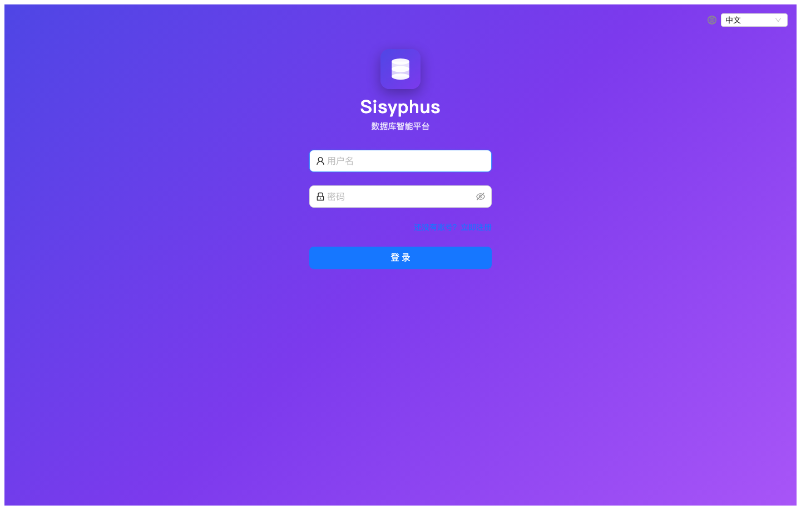

| 账号 | 密码 | 角色说明 |
|------|------|----------|
| `admin` | `Admin@123` | 超级管理员，拥有所有权限 |
| `dba` | `Admin@123` | DBA，管理实例与工单审批 |
| `developer` | `Admin@123` | 开发者，提交工单与数据查询 |

> **首次使用生产环境，请立即在「权限管理 → 用户」中修改默认密码。**

---

## 首页仪表盘

登录后进入首页，展示平台整体运行状态：

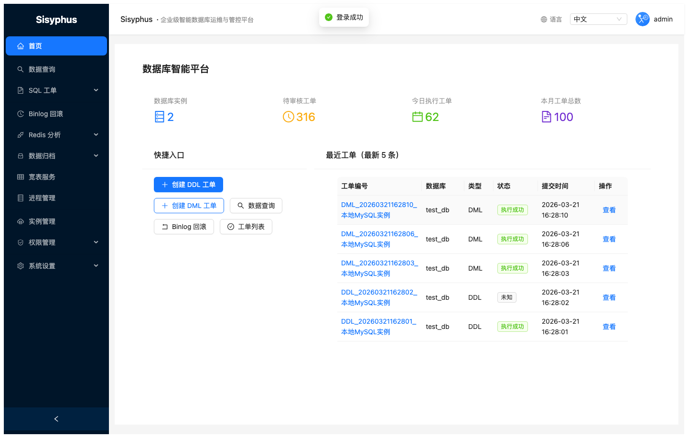

首页显示内容：
- 待审批工单数、今日执行工单数
- 最近工单动态列表
- 系统快捷入口

---

## 实例管理

在左侧导航点击 **实例管理**，进入数据库实例列表：

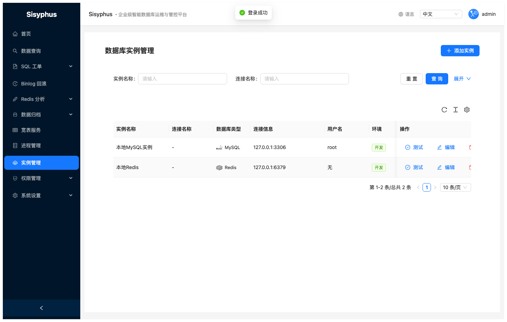

### 新增实例

1. 点击右上角 **+ 添加实例**
2. 填写实例信息：

| 字段 | 说明 |
|------|------|
| 实例名称 | 用于在工单/查询中识别的名称 |
| 连接名称 | 连接标识（可选，默认同实例名称） |
| 数据库类型 | MySQL / Redis / ClickHouse / HBase |
| 主机地址 | IP 或域名 |
| 端口 | 默认 MySQL:3306，Redis:6379 |
| 用户名/密码 | 数据库连接账号 |
| 环境 | 开发 / 测试 / 生产 |

3. 点击 **测试**，验证连通性
4. 点击 **确定** 保存

> **权限建议**：MySQL 实例账号需要 `SELECT, INSERT, UPDATE, DELETE, CREATE, DROP, ALTER, INDEX, REPLICATION SLAVE` 权限，DML 备份库账号还需要写入权限。

---

## SQL 工单

SQL 工单是平台核心功能，支持 DDL（结构变更）和 DML（数据变更）两种类型，所有变更经过 goInception 审核后才能执行。

**工单生命周期：**

```
提交(待审核) → 审批通过 → 执行中 → 执行成功
                  ↓                → 执行失败
               已驳回
```

### 工单列表

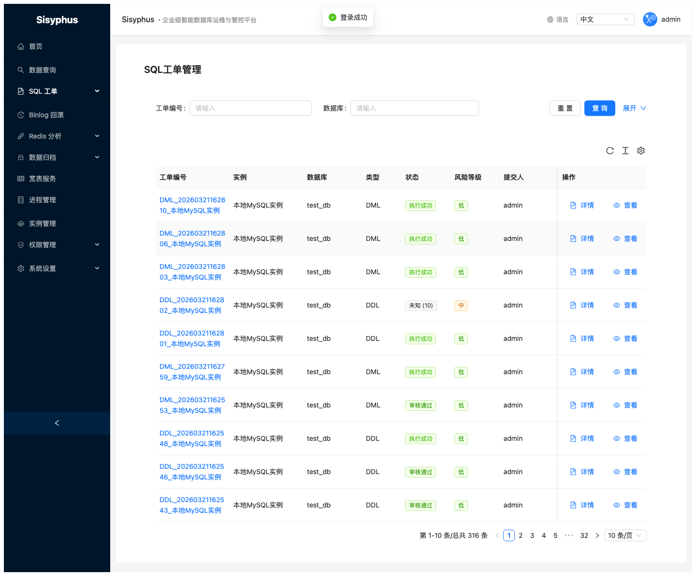

列表展示所有工单，支持按工单编号、数据库、状态、工单类型筛选。每条工单显示：
- 工单编号（可点击进入详情）
- 关联实例与数据库
- 工单类型（DDL/DML/导出）
- 当前状态（待审核/审批通过/执行成功/执行失败等）
- 风险等级
- 提交人

### 创建 DDL 工单

点击左侧 **SQL 工单 → 创建DDL工单**：


操作步骤：
1. 选择数据库实例和目标数据库
2. 在 Monaco 编辑器中输入 DDL SQL（支持语法高亮）
3. 点击 **审核**，等待 goInception 语法检查结果
4. 审核通过后，选择执行方式：
   - **goInception**：通用执行，支持备份
   - **gh-ost**：适合大表在线 DDL，无锁零停机
5. 填写变更说明（remark）
6. 点击 **提交**

### 创建 DML 工单

点击左侧 **SQL 工单 → 创建DML工单**：

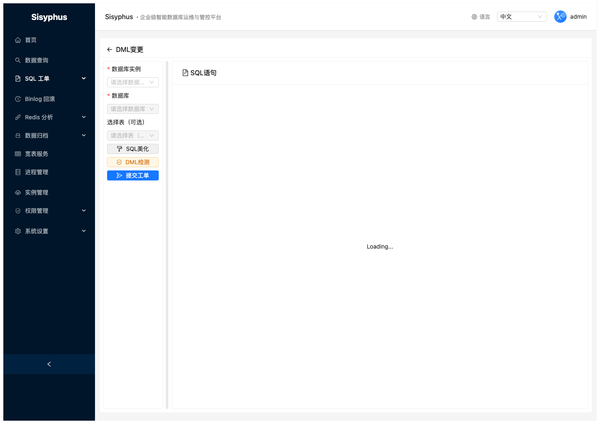

操作步骤：
1. 选择数据库实例和目标数据库
2. 输入 DML SQL（INSERT/UPDATE/DELETE）
3. 勾选 **需要备份**（推荐）：goInception 执行时自动生成反向回滚 SQL
4. 点击 **审核** → 查看审核结果
5. 点击 **提交**

> **关于备份与回滚**：开启备份后，执行完成的工单详情页会出现「回滚SQL」入口，可查看每条语句对应的反向 UPDATE/INSERT/DELETE，一键生成回滚工单。

### 工单审批与执行

进入工单详情页：
- **DBA 审批**：点击「审批通过」或「驳回」，可附带驳回理由
- **执行**：审批通过后，点击「执行」开始执行；执行结果逐条展示
- **回滚 SQL**：DML+备份工单执行成功后，点击「回滚SQL」查看可用的反向 SQL

---

## 数据查询

进入 **数据查询** 页面：

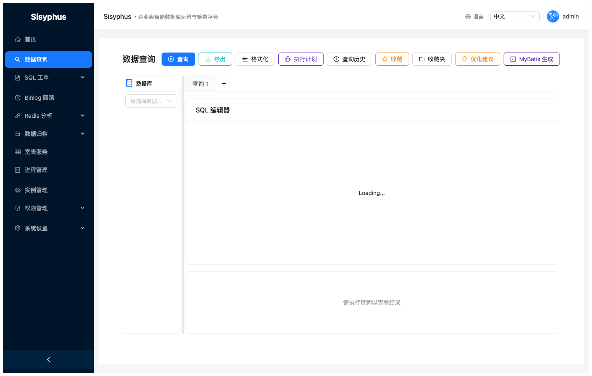

### 功能说明

| 功能 | 说明 |
|------|------|
| 实例/数据库选择 | 左侧面板选择实例，展开数据库/表/列树 |
| Monaco SQL 编辑器 | 支持 SQL 语法高亮、自动补全、多标签页 |
| 执行查询 | 点击「查询」或按 `Ctrl+Enter` |
| 查询历史 | 点击「查询历史」查看最近 50 条执行记录 |
| 收藏夹 | 点击「收藏」保存当前 SQL；点击「收藏夹」管理 |
| 执行计划 | 点击「执行计划」获取 EXPLAIN 结果 |
| 优化建议 | 点击「优化建议」获取 AI 索引优化和改写建议 |
| 数据导出 | 查询结果支持导出为 Excel / CSV / JSON |
| MyBatis 生成 | 根据表 DDL 自动生成 MyBatis XML 映射文件 |

### 多标签查询

点击标签栏的 `+` 可新建查询标签页，双击标签可重命名，支持同时运行多个独立查询。

---

## 表结构查看

进入 **工具 → 表结构**：

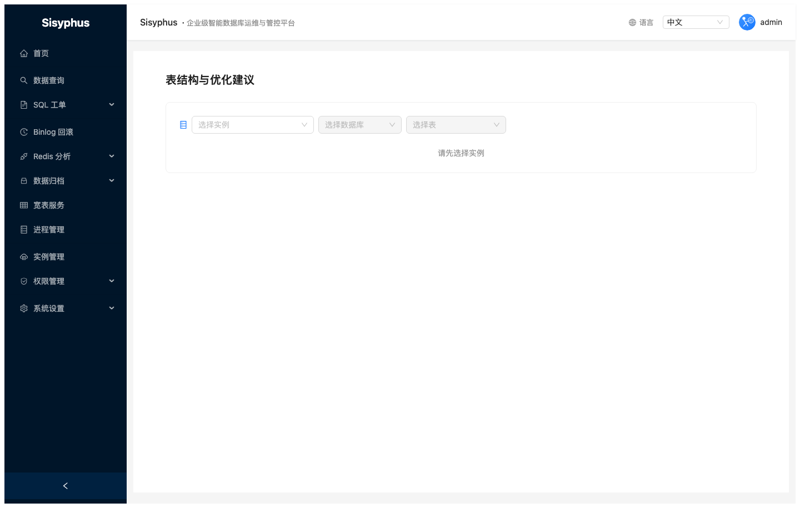

选择实例和数据库后，展示：
- **列信息**：列名、类型、是否 NULL、键类型、默认值、注释
- **DDL**：建表语句（语法高亮展示）

---

## 进程管理

进入 **进程管理**：

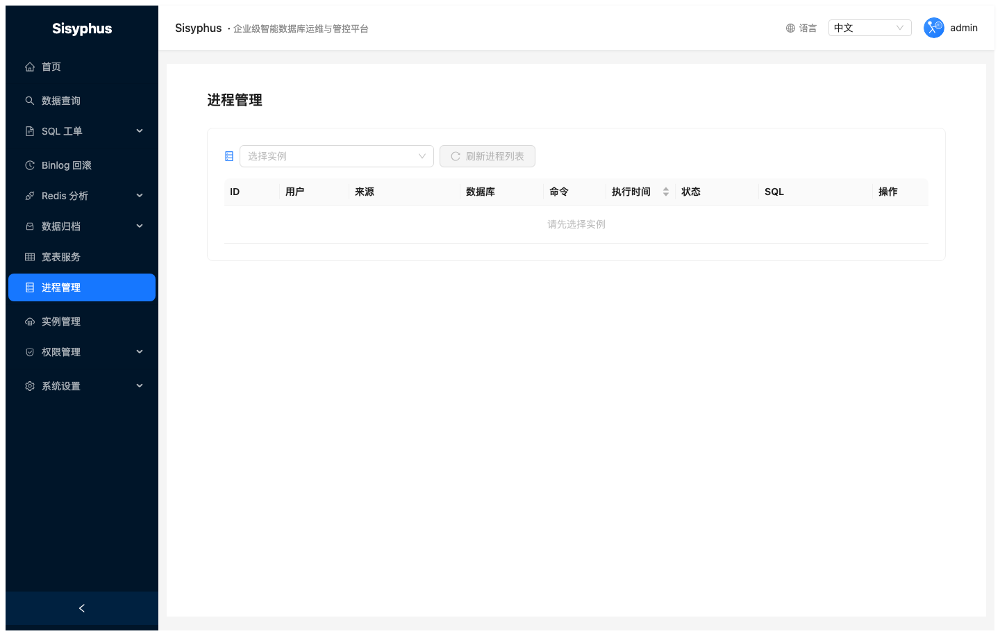

展示选定 MySQL 实例的当前进程列表，支持：
- 按实例筛选
- 查看执行中的 SQL、连接 IP、执行时长
- 点击 **Kill** 终止异常进程（需要权限）

---

## Binlog 回滚

进入 **Binlog 回滚**：

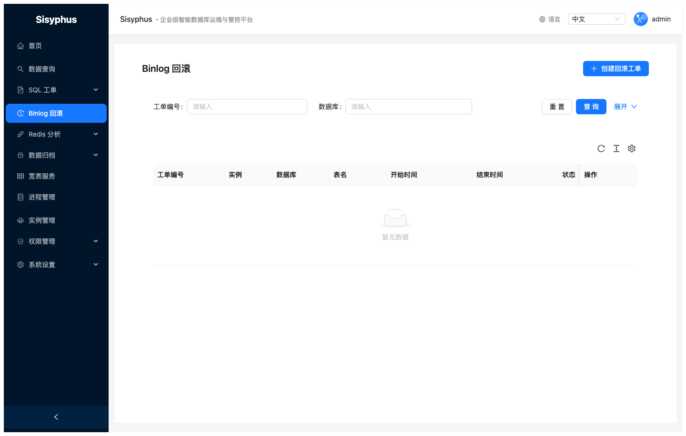

功能说明：
1. 选择 MySQL 实例
2. 填写时间范围（开始/结束时间）
3. 可选指定数据库和表名过滤
4. 选择操作类型（INSERT/UPDATE/DELETE）
5. 点击「分析」生成回滚 SQL
6. 确认后点击「创建回滚工单」，自动提交 DML 工单

> 适用于误操作数据恢复，通过 Binlog 重建历史变更的逆向操作。

---

## Redis 分析

进入 **Redis 分析**，包含热 Key 和大 Key 两个子模块：

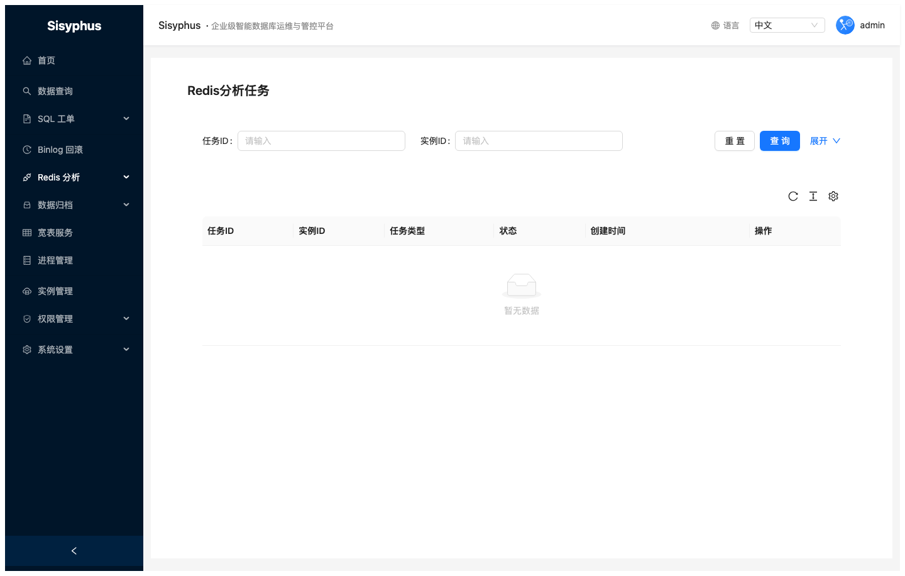

### 热 Key 分析

扫描指定 Redis 实例在时间窗口内的高频访问 Key，展示 Key 名称、访问次数、数据类型。

### 大 Key 分析

扫描 Redis 实例中占用内存较大的 Key，展示 Key 名称、内存大小、元素数量、数据类型。

**使用步骤**：
1. 选择 Redis 实例
2. 点击「创建任务」，配置扫描参数
3. 等待任务完成后查看分析结果

---

## 数据归档

进入 **数据归档 → 归档配置**：

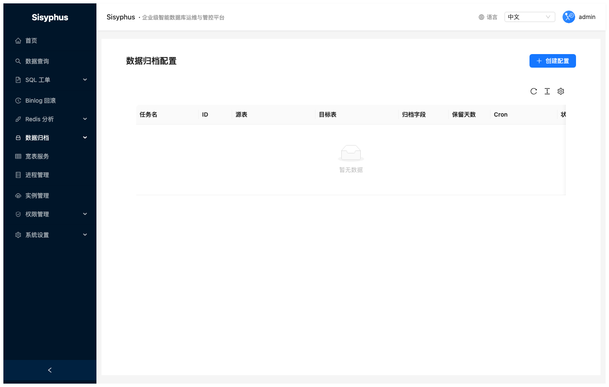

### 创建归档配置

| 字段 | 说明 |
|------|------|
| 任务名 | 归档任务标识 |
| 源实例/数据库/表 | 要归档数据的来源 |
| 目标实例（可选） | 不填则为删除模式，填写则迁移至目标表 |
| 归档字段 | 用于判断数据新旧的时间字段（如 `created_at`） |
| 保留天数 | 保留最近 N 天的数据，超出部分归档 |
| 归档条件 | 额外的 WHERE 条件（可选） |
| Cron 表达式 | 定时执行（如 `0 2 * * *` 每天凌晨 2 点） |

底层使用 **pt-archiver** 执行归档，支持大表小批次安全迁移。

---

## 宽表服务

进入 **宽表服务**：

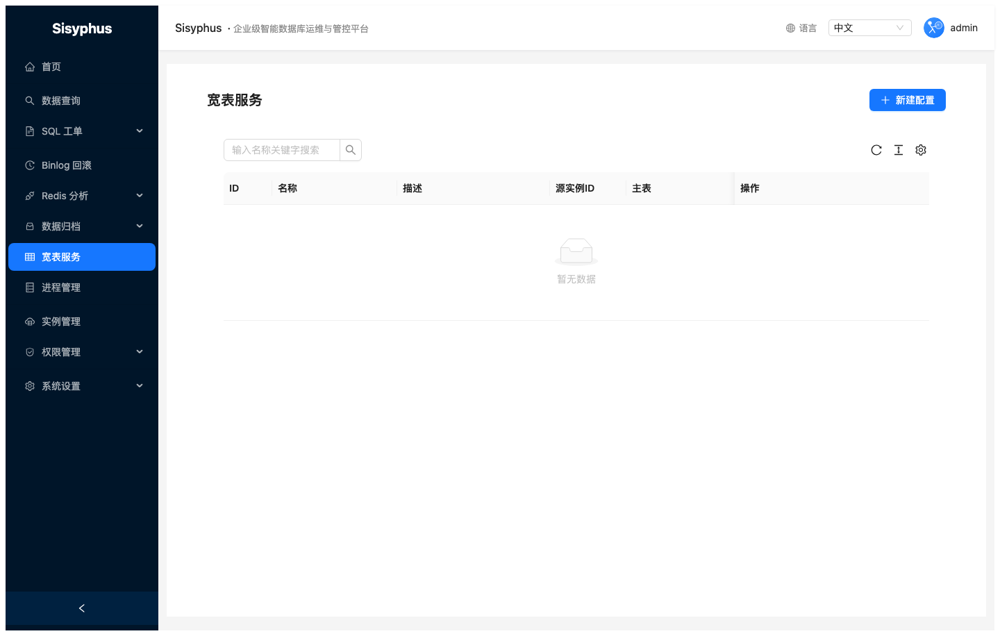

宽表服务允许将多表 JOIN 查询配置化，支持：
- **配置 JOIN 规则**：指定主表、JOIN 表、ON 条件、别名
- **字段映射**：定义输出字段与来源表达式
- **数据查询**：直接在平台执行宽表查询，返回分页结果
- **全量同步**：将宽表结果同步写入目标实例/表

### 创建宽表配置

1. 填写名称和描述
2. 选择源实例，填写主库、主表
3. 配置 JOIN 表（数据库、表名、别名、JOIN 类型、ON 条件）
4. 配置字段映射（来源表达式 → 输出别名）
5. 可选：填写同步条件（WHERE 子句）
6. 可选：配置目标实例/库/表（用于全量同步）

---

## 权限管理

进入 **权限管理**，包含用户、角色、权限三个子页面：

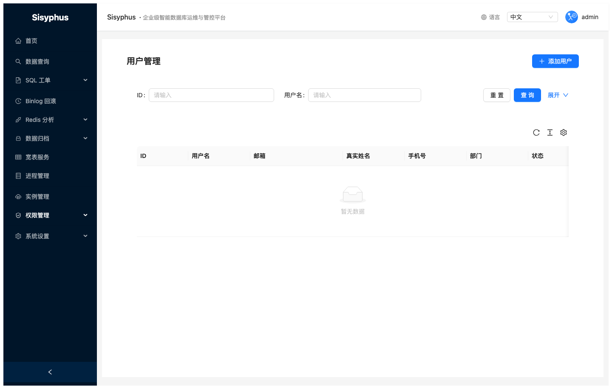
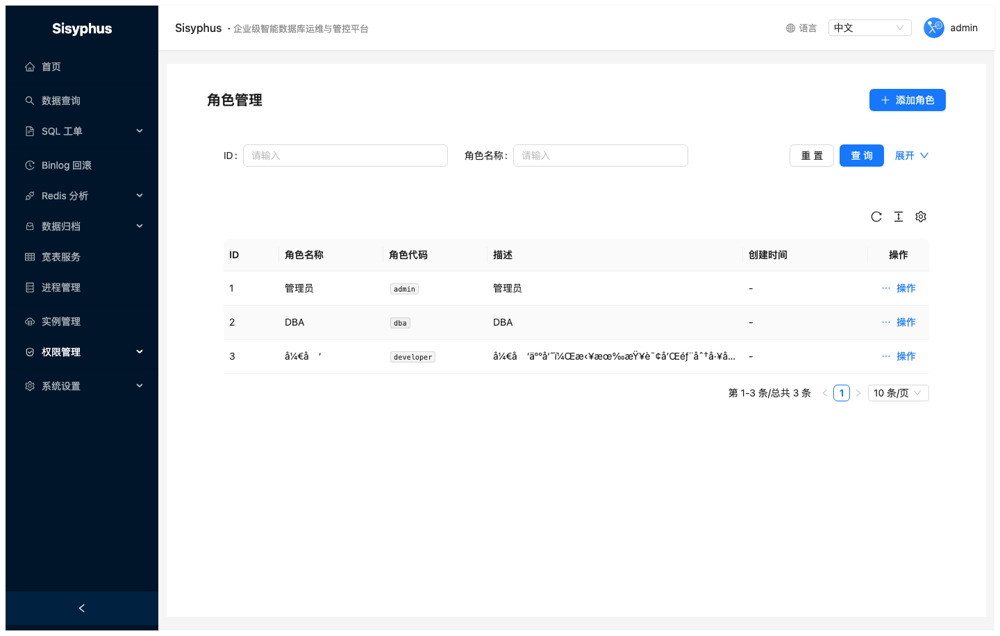

### 权限模型

系统采用 **RBAC（基于角色的访问控制）** 三层模型：

```
用户 (User) → 角色 (Role) → 权限点 (Permission)
```

### 内置角色

| 角色 | 代码 | 说明 |
|------|------|------|
| 超级管理员 | `admin` | 拥有所有权限 |
| DBA | `dba` | 数据库管理员，可审批和执行工单 |
| 开发者 | `developer` | 可提交工单和数据查询 |

### 用户管理操作

- **创建用户**：填写用户名、密码、邮箱、真实姓名
- **分配角色**：在用户列表点击「角色」为用户绑定角色
- **禁用/启用**：控制用户登录权限
- **重置密码**：管理员可重置任意用户密码

### 角色管理操作

- **创建角色**：填写角色名称、代码、描述
- **配置权限**：点击「配置权限」，在权限树中勾选对应权限点
- 权限点按模块分组，支持按模块批量选择
- **实例权限**：在角色行「更多」菜单中选「实例权限」，配置该角色可访问的实例及能力（表 `sisyphus_role_instance_permissions`）

### 实例级权限（查询 / DDL / DML / 导出）

在全局权限点（如 `sql_query:execute`、`sql_order:create`）之外，可限制用户**能在哪些实例上**使用**哪类能力**：

| 能力 | 说明 |
|------|------|
| `query` | 数据查询（各引擎）、进程列表、表结构等依赖实例元数据的查询类能力 |
| `ddl` | 该实例上的 DDL 类 SQL 工单及关联 Inception 审核 |
| `dml` | 该实例上的 DML 类 SQL 工单 |
| `export` | 查询结果导出（Excel / CSV / JSON / INSERT SQL） |

**配置入口**

- **权限管理 → 用户**：用户行的「实例权限」——用户直授（表 `sisyphus_user_instance_permissions`）。
- **权限管理 → 角色**：角色「更多 → 实例权限」——该角色下所有用户继承（表 `sisyphus_role_instance_permissions`）。

**生效规则**：同一用户的有效范围 = **所有角色的实例授权 ∪ 用户直授**。拥有 **`instance:manage`** 的用户不受上述实例表限制。

**默认**：若用户（含其角色）在实例授权中**没有任何记录**，则不额外按实例收紧；配置实例授权后，仅允许已声明的实例与能力。

**接口**：`GET/PUT /api/v1/users/{id}/instance-permissions`、`GET/PUT /api/v1/roles/{id}/instance-permissions`。实例列表支持查询参数 `instance_permission_scope`（`query` / `ddl` / `dml` / `export`）用于下拉框过滤。

---

## 附录：更新手册与 README 中的界面截图

中文手册插图位于 `docs/screenshots/zh-CN/`；英文手册对应 `docs/screenshots/en/`。与当前 UI 不一致时在本地重新生成两套即可。前置条件：后端 `:8000`、前端 `:8001`、已按 `migrations/` / `scripts` 初始化库与测试数据；登录账号与 E2E 一致（如 `admin` / `Admin@123`）。详细步骤见仓库根目录 [README（中文）](../README.zh-CN.md) 中的「E2E 自动化测试」。

```bash
cd e2e
npm install && npx playwright install chromium
npm run test:screenshots
```

完成后将更新的 PNG 与文档一并提交。

---

## FAQ

### 工单审核失败怎么办？

goInception 会在审核结果中显示具体的错误原因，常见问题：
- 表不存在：确认数据库名和表名是否正确
- 缺少主键：DDL 建表需要包含主键
- SQL 语法错误：检查 SQL 格式

### 如何查看执行失败的详细原因？

进入工单详情页，点击「执行记录」标签，每条 SQL 的执行结果和错误信息都会逐条展示。

### 查询页面报 "请选择数据库实例" 是什么意思？

需要先在左侧「数据库」面板的下拉框中选择一个数据库实例，再输入 SQL 执行查询。

### DML 回滚 SQL 在哪里查看？

工单执行成功后（需要在创建时勾选了「需要备份」），在工单详情页点击顶部的「回滚SQL」按钮。

### 如何修改个人密码？

点击右上角头像进入「个人中心」，可修改密码和个人信息。
